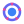

# Nebula glossary

*Version française [plus bas](#français).*

The common vocabulary of the framework, the reference for naming the code, the documentation and the interface.
Nebula and Univers are in use, the class of the latter spelled `Universe`, Galaxy for a project file, and Stargate for what a galaxy exposes: for the other terms, the last column gives the name the code and the documentation use today.

Each term has its icon, in the colors of the theme of NebulaStudio: the logo for Nebula, and for the others an SVG of
`NebulaStudio/resources/icons/`, which NebulaStudio shows where it deals with what the term names.

| Term    | Icon | Definition | Today |
| ------- | ---- | ---------- | ----- |
| Nebula  |  | The framework | In use: the name of the project, of its namespace, macros and package, formerly AppForge |
| Univers |  | The global scene, the root container of the application | In use: `Universe`, the application assembled from instances, formerly `ForgeApplication`, shown in the edition zone of NebulaStudio (`EditionScene`); its icon is the one of **New** |
| Galaxy  |  | A group of components | A project file (`.nbp`), named after its file, with its description (`GalaxyInfo`, read by `Universe::readGalaxy()`), listed in the **Galaxies** tab of NebulaStudio, which tells whether its plugins are known, and placed in an application, or in another galaxy, as one component, a `Galaxy` (`Universe::instantiateGalaxy()`), which owns the components of its file; in the edition zone, a colored zone (`ZoneItem`), known to NebulaStudio only, groups components too: an application runs without them. Its icon is the one of that tab, of its galaxies, placed or listed, of **Open galaxy**, of **Description...** and of **Add zone** |
| Astre   |  | A component, with no hierarchy: no Astre is the parent or the child of another | An instance of a component (`Component`), named in its application (`Greeter1`); its icon is the one of the components in their list |
| Comet   |  | A configuration component, loaded at startup | A settings file (`SettingsFile`), read by `Universe::start()` before the first component starts; its icon is the one of **Add settings file**, **Edit settings file...** and of its dialog |
| Stargate |  | The bridge between a Galaxy and the one that uses it | In use: `Stargate`, a component Core builds (`Universe::addStargate()`), which exposes interfaces and properties of the components of its galaxy, the other way round for its interfaces: placed, the galaxy provides and consumes them, and its properties are those it exposes; its icon is the one of **Add stargate**, **Expose...**, **Edit stargate...**, of its dialog, of the stargates of the edition zone and of the properties they expose in the property editor |

The Astres of an Univers are side by side: they are tied to one another only by the bindings of their interfaces, a
Galaxy groups them without owning them, a Comet holds properties of some of them, and a Stargate exposes some of
their interfaces and properties to the Galaxy that uses the one they are in.

The glossary does not rename the other notions: plugin, interface, binding, property, project, and NebulaStudio, the editor.

---

## Français

Le vocabulaire commun du framework, la référence pour nommer le code, la documentation et l'interface. Le code et la
documentation emploient Nebula et Univers, la classe de ce dernier s'écrivant `Universe`, Galaxy pour un fichier de projet, et Stargate pour ce qu'une galaxy expose : pour les autres termes, la dernière colonne donne le nom qu'ils y portent aujourd'hui.

Chaque terme a son icône, aux couleurs du thème de NebulaStudio : le logo pour Nebula, et pour les autres un SVG de
`NebulaStudio/resources/icons/`, que NebulaStudio montre là où il traite de ce que le terme nomme.

| Terme   | Icône | Définition | Aujourd'hui |
| ------- | ----- | ---------- | ----------- |
| Nebula  |  | Le framework | Employé : le nom du projet, de son espace de noms, de ses macros et de son paquet, auparavant AppForge |
| Univers |  | La scène globale, conteneur racine de l'application | Employé : `Universe`, l'application assemblée à partir d'instances, auparavant `ForgeApplication`, montrée dans la zone d'édition de NebulaStudio (`EditionScene`) ; son icône est celle de **New** |
| Galaxy  |  | Un regroupement de composants | Un fichier de projet (`.nbp`), nommé d'après son fichier, avec sa description (`GalaxyInfo`, lu par `Universe::readGalaxy()`), listé dans l'onglet **Galaxies** de NebulaStudio, qui dit si ses plugins sont connus, et posé dans une application, ou dans une autre galaxy, comme un seul composant, une `Galaxy` (`Universe::instantiateGalaxy()`), qui possède les composants de son fichier ; dans la zone d'édition, une zone colorée (`ZoneItem`), connue de NebulaStudio seulement, regroupe aussi des composants : une application tourne sans elles. Son icône est celle de cet onglet, de ses galaxies, posées ou listées, de **Open galaxy**, de **Description...** et de **Add zone** |
| Astre   |  | Un composant, sans hiérarchie : aucun Astre n'est le parent ni l'enfant d'un autre | Une instance d'un composant (`Component`), nommée dans son application (`Greeter1`) ; son icône est celle des composants dans leur liste |
| Comet   |  | Composant de configuration chargé au démarrage | Un fichier de réglages (`SettingsFile`), lu par `Universe::start()` avant que le premier composant démarre ; son icône est celle de **Add settings file**, **Edit settings file...** et de sa fenêtre |
| Stargate |  | Le pont entre une Galaxy et celle qui l'utilise | Employé : `Stargate`, un composant que Core construit lui-même (`Universe::addStargate()`), qui expose des interfaces et des propriétés des composants de sa galaxy, à l'inverse pour ses interfaces : posée, la galaxy les fournit et les consomme, et ses propriétés sont celles qu'elle expose ; son icône est celle de **Add stargate**, **Expose...**, **Edit stargate...**, de sa fenêtre, des stargates de la zone d'édition et des propriétés qu'elles exposent dans l'éditeur de propriétés |

Les Astres d'un Univers sont côte à côte : ils ne sont liés entre eux que par les liens de leurs interfaces, une Galaxy
les regroupe sans les posséder, une Comet tient des propriétés de certains d'entre eux, et une Stargate expose certaines
de leurs interfaces et de leurs propriétés à la Galaxy qui utilise celle où elle est.

Le glossaire ne renomme pas les autres notions : plugin, interface, lien, propriété, projet, et NebulaStudio, l'éditeur.
