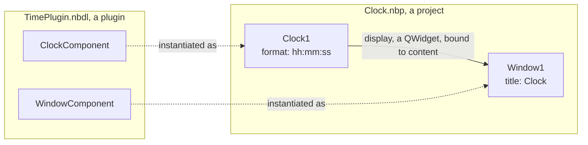
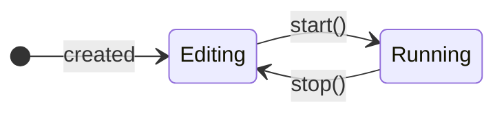

# Concepts

An application made with Nebula is a set of **instances** of **components**, set by their **properties** and tied to
one another by the **bindings** of their **interfaces**. **Plugins** provide the components; a **project** file holds
the assembly; NebulaStudio edits it, and any application runs it.

## Plugins and components

A **plugin** is a library, a `.nbdl` file, that Nebula loads while it runs: it provides components, and nothing else.
Applications find the plugins in `plugins/` next to them, and in the directories given with `--plugin-dir`. Each plugin
has an id, `AcmeCorp.Acme.TimePlugin` say, the organization, the project and the name of its target, and is checked
before it is loaded: it has to be built against the same major version of Nebula as the application, and no newer one.

A **component** is a C++ class of a plugin, deriving from `Nebula::Component`: a window, a clock, a log, a connection to
a device. Its id is the one of its plugin followed by its name, `AcmeCorp.Acme.TimePlugin.ClockComponent`. Its
description and its category, given in its class, are shown in NebulaStudio.

## Instances and properties

An **instance** is a component created in an application, with a name of its own: `Clock1`, `Clock2`... Instances are
side by side: none is the parent or the child of another.

Its **properties** are those of its class (`Q_PROPERTY`), and those of the objects it chooses to show, a widget it is
made of say: what NebulaStudio edits, and what a project saves.

## Interfaces and bindings

Instances do not know one another: they meet through **interfaces**, pointers they make available under a name.

- An instance **provides** an interface, a pointer of a type: `display`, a `QWidget*`.
- An instance **consumes** an interface, a member it wants to be given a pointer of a type in: `content`, a `QWidget*`.
- A **binding** ties what one consumes to what another provides, whatever their names, as long as their types are the
  same. An interface can be provided to several consumers; a consumer is bound to a single provider, unless it consumes
  a **list**, which is bound to several, in an order.
- A provided interface is **available** once its pointer is set: the consumers bound to it get the pointer then, and
  are told before it goes.
- A consumed interface can be **mandatory**: the instance does not work without it. Nothing prevents it from starting,
  but NebulaStudio marks it in amber until it is bound.

## Two modes

Each instance, and the application as a whole, is either **edited** or **running**.

While it is edited, an application is assembled: instances added, set, bound, renamed or removed. Started, its instances
start in their order, each of them able to refuse, which stops those already started. While it runs, it is not
assembled; what its instances do may change their properties. Stopped, every property gets the value it had when it
started again: running an application does not change its project.

## Projects and galaxies

A **project** is a JSON file, `.nbp`, that holds an application: the plugins it needs, its instances with their
properties, and their bindings; and, for NebulaStudio, where each instance is in the edition zone.

A project file is also a **galaxy**, named after its file: a part of an application that is placed in another one as a
single instance, as many times as needed, each with its own values. A galaxy has what its **stargates** expose: the
interfaces and properties of its instances that those who place it see. See
[galaxies and stargates](Galaxies-and-Stargates.md).

## Settings files

A **settings file** keeps the values that the user of an application gives some properties, from one run to the next:
the profile they chose, the size of a window. The project gives these properties their default values; the file, read
when the application starts and written as they change, gives them those of the user. See
[settings files](Settings-Files.md).

## The vocabulary

Nebula names some of its notions after the sky, in its code, its documentation and NebulaStudio, each with its icon.
The [glossary](https://github.com/Shuko83/Nebula/blob/main/docs/glossary.md) defines them, in English and in French.

| Term | Icon | What it names |
| --- | --- | --- |
| Nebula |  | The framework |
| Univers |  | The application assembled from instances, the class `Nebula::Universe`, shown in the edition zone of NebulaStudio |
| Galaxy |  | A project file, placed in an application as one instance |
| Astre |  | An instance of a component |
| Comet |  | A settings file |
| Stargate |  | What a galaxy exposes to the application that places it |

Plugin, component, interface, binding, property and project keep their usual names.
