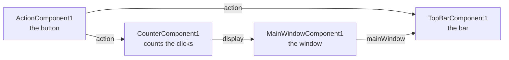

# Lesson 2 · Assemble without code

*[The course](Course.md) › Lesson 2*

You assemble your first application: a window with a button in a bar at its top, which shows how many times the
button was clicked. You write no code: the four building blocks come with Nebula, in `WidgetsPlugin`.

**You need**: [lesson 1](Course-1-Get-Ready.md) done. NebulaStudio is started, and `WidgetsPlugin` is loaded
(**Plugins** tab, click `WidgetsPlugin`, click **Load**).

## What you will assemble



Four **instances**, and four **links** between them. An arrow goes from what an instance **provides** to the instance
that **consumes** it: the button provides its `action` to the bar, which shows it, and to the counter, which counts
its clicks.

| Component | What it is | It provides | It consumes |
| --- | --- | --- | --- |
| `MainWindowComponent` | A window | `mainWindow`, itself | `centralWidget`, what it shows in its middle |
| `TopBarComponent` | The bar at the top of a window | | `mainWindow`, the window it goes in; `actions`, its buttons; `widgets`, what it shows after them |
| `ActionComponent` | A button | `action`, the button | |
| `CounterComponent` | A counter of clicks | `display`, a text with its count | `action`, the button it counts the clicks of |

## Exercise 2.1 · Place the four instances

**Goal**: four boxes in the edition zone.

**Steps**

1. Click the **Components** tab.
2. Put the mouse on `MainWindowComponent`, press the left button, keep it pressed, move to the top left of the
   edition zone, release.

   *You should see:* a box named `MainWindowComponent1`. Under its name, two rows: `centralWidget` with a circle on
   the left edge, and `mainWindow` with a disc on the right edge.

3. The same way, drop `TopBarComponent` on the right of the first box.

   *You should see:* a box `TopBarComponent1` with three rows, all with their mark on the left edge: `mainWindow*`,
   `actions` and `widgets`. In its top left corner, **an exclamation mark in an amber disc**.

4. Drop `ActionComponent` under the first box.

   *You should see:* a box `ActionComponent1` with one row, `action`, and a disc on the right edge.

5. Drop `CounterComponent` under the second box.

   *You should see:* a box `CounterComponent1` with `action*` on the left edge, `display` on the right edge, and the
   amber mark too.

6. Move the boxes apart, so that none covers another: press the left button on the name of a box, move, release.

**How to read a box**

- A mark on the **left** edge is an interface the instance **consumes**: something it needs. A circle for one, two
  stacked circles for a list of several.
- A mark on the **right** edge is an interface the instance **provides**: something it offers.
- A star after a name, `mainWindow*`, says that the instance does not work without it.
- The amber mark says that such an interface is still linked to nothing.

**Check**: look at the problems, under the edition zone. Two rows:

| Component | Problem |
| --- | --- |
| `TopBarComponent1` | `mainWindow (QMainWindow) is bound to nothing` |
| `CounterComponent1` | `action (QAction) is bound to nothing` |

The third column, **How to fix it**, already tells what the next exercise does.

**If it does not work**

- *Nothing can be dragged from the list*: the list shows no component of `WidgetsPlugin`. Load it, see the top of this
  page.
- *You dropped the wrong component, or one twice*: click its box, press Delete.

## Exercise 2.2 · Link them

A **link** joins an interface an instance provides to an interface another one consumes. You draw it with the mouse,
from one mark to the other.

**Goal**: the four links of the picture above.

**Steps**

1. **The window to the bar.** Put the mouse on the disc at the right of `mainWindow`, in `MainWindowComponent1`. Press
   the left button, keep it pressed, move to the circle at the left of `mainWindow*`, in `TopBarComponent1`, release.

   *You should see:* while you move, a line follows the mouse, and the marks it cannot be linked to are dimmed. Once
   released, a line joins the two marks, and the amber mark of `TopBarComponent1` is gone.

2. **The button to the bar.** Drag from the disc of `action`, in `ActionComponent1`, to the two stacked circles of
   `actions`, in `TopBarComponent1`.

   *You should see:* a second line.

3. **The button to the counter.** Drag from the same disc of `action`, in `ActionComponent1`, to the circle of
   `action*`, in `CounterComponent1`.

   *You should see:* a third line, from the same disc, and the amber mark of `CounterComponent1` is gone.

4. **The counter to the window.** Drag from the disc of `display`, in `CounterComponent1`, to the circle of
   `centralWidget`, in `MainWindowComponent1`.

   *You should see:* a fourth line.

5. Put the mouse on a line, without clicking.

   *You should see:* the line gets thicker, and a small text tells what it links:
   `TopBarComponent1.mainWindow is bound to MainWindowComponent1.mainWindow`.

**Check**: four lines, no amber mark, and the problems say `Every component of the application has the interfaces it
needs`.

**If it does not work**

- *The line disappears when you release*: you released beside the mark, or on a mark of another type. The two ends
  must have the same type: put the mouse on a mark to read its type.
- *You linked the wrong marks*: click the line, it changes color, press Delete. Or press Ctrl+Z.

## Exercise 2.3 · Set a property

A **property** is a value of an instance. The button has a `text`, what is written on it.

**Goal**: the button says `Count`.

**Steps**

1. Click the box `ActionComponent1`.

   *You should see:* the properties, on the right, list `text`, whose value is `Action`, and `shortcut`.

2. Click the value `Action`, type `Count` in its place, press Enter.

   *You should see:* the value is `Count`. The status bar does not need to say anything.

**Check**: click another box, then `ActionComponent1` again: `text` is still `Count`.

## Exercise 2.4 · Run it

So far the application is **edited**. Now you **run** it: its instances start, and do their work.

**Steps**

1. Open the menu **Run** and choose **Start**, or press F5.

   *You should see:* a new window opens, titled `Nebula`, with a bar at its top that has a button `Count`, and the
   text `Triggered 0 times` in its middle. In NebulaStudio, each box has a small triangle in a corner: it runs.

2. Click **Count** three times, in the new window.

   *You should see:* `Triggered 3 times`.

3. Come back to NebulaStudio and try to move a box.

   *You should see:* it does not move. While the application runs, nothing is edited.

4. Open the menu **Run** and choose **Stop**, or press Shift+F5.

   *You should see:* the window `Nebula` closes, and the triangles go.

5. Click the box `CounterComponent1` and read its property `count`.

   *You should see:* `0`, not 3. Stopping gives every property the value it had before the start: running an
   application never changes what you assembled. [Lesson 3](Course-3-Keep-What-the-User-Chooses.md) keeps the
   count.

**If it does not work**

- *No window opens*: look behind NebulaStudio, the window may be under it.
- *The window has no button*: the link from `action` to `actions` is missing. Stop, then do step 2 of exercise 2.2.
- *The count stays at 0*: the link from `action` to `action*` of the counter is missing.

## Exercise 2.5 · Save it, and run it without NebulaStudio

What you assembled is a **project**. Saved, it is a file that any application made with Nebula can run.

**Steps**

1. Open the menu **File** and choose **Save As...**.

   *You should see:* a dialog, **Save project**, opened in a folder named `scene`.

2. Type `Counters` as the file name, then click **Save**.

   *You should see:* the title of NebulaStudio now starts with `Counters`. The file is
   `C:\Nebula\NebulaStudio\Release\bin\scene\Counters.nbp`.

3. Open a terminal: press the Windows key, type `PowerShell`, press Enter.
4. Copy this line into the terminal, then press Enter:

   ```powershell
   & "C:\Nebula\ExampleUniverseApp\Release\bin\ExampleUniverseApp.exe" "C:\Nebula\NebulaStudio\Release\bin\scene\Counters.nbp"
   ```

   *You should see:* the window `Nebula` again, with its button `Count`, this time without NebulaStudio.
   `ExampleUniverseApp` is a small application that comes with Nebula, and runs the project it is given.

5. Click **Count** a few times, then close the window with its cross.

   *You should see:* the terminal is ready for another command: the application ended.

**Check**: the project runs on its own.

**Good to know**: `Counters.nbp` is a text file. Open it with the Notepad: you can read your four instances
(`components`), the text `Count`, and your four links (`bindings`).

## Your turn

**One button, two counters.** Add a second counter that counts the clicks of the same button, shows `Also 0`, `Also
1`... and is shown in the bar, after the button. Then save the project.

What you need to know: an interface can be provided to several instances at once; `%1` in the `text` of a counter
stands for its count; the bar shows the widgets linked to `widgets` after its buttons.

<details>
<summary>Solution</summary>

1. Drag `CounterComponent` from the **Components** tab to the edition zone: `CounterComponent2`, with an amber mark.
2. Drag from the disc of `action`, in `ActionComponent1`, to the circle of `action*`, in `CounterComponent2`. The
   mark goes.
3. Drag from the disc of `display`, in `CounterComponent2`, to the two stacked circles of `widgets`, in
   `TopBarComponent1`.
4. Click `CounterComponent2`. In the properties, click the value of `text`, type `Also %1`, press Enter.
5. **Run** > **Start**: one click on **Count** changes both texts, `Triggered 1 times` in the middle and `Also 1` in
   the bar. **Run** > **Stop**.
6. **File** > **Save** (Ctrl+S).

</details>

**Break it, then fix it from a menu.** Remove the link between the button and the second counter, read what
NebulaStudio says, then make the link again without dragging.

<details>
<summary>Solution</summary>

1. Click the line between `action` of `ActionComponent1` and `action*` of `CounterComponent2`, then press Delete.
   `CounterComponent2` has its amber mark again, and the problems have a row for it.
2. **Run** > **Start**: the application starts all the same, and `Also 0` no longer changes. The mark only warns.
   **Run** > **Stop**.
3. Right-click the circle of `action*`, in `CounterComponent2`. In the menu, choose **Bind to**, then
   `ActionComponent1.action`. The link is back.

</details>

## What you learned

- An application is made of instances, linked from what one provides to what another consumes.
- A star marks an interface an instance cannot do without; the amber mark and the problems tell when it is missing.
- **Run** > **Start** runs the application; **Stop** gives every property its value back.
- A project is a file, `.nbp`, that runs without NebulaStudio.

**Next**: [Lesson 3 · Keep what the user chooses](Course-3-Keep-What-the-User-Chooses.md)
