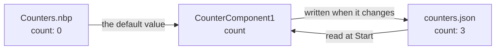

# Lesson 3 · Keep what the user chooses

*[The course](Course.md) › Lesson 3*

In lesson 2, the count went back to 0 each time the application stopped. Here you have it kept from one run to the
next, with a **settings file**: a file in which an application writes the values of some properties, and reads them
back the next time it starts.

**You need**: [lesson 2](Course-2-Assemble-Without-Code.md) done, and its project saved as `Counters.nbp`.

## How a settings file works



- The **project** holds the value you set in NebulaStudio: the **default value**.
- The **settings file** holds the value of the **user**, the person who runs the application.
- At **Start**, the property takes the value of the file. While the application runs, each change is written to the
  file. At **Stop**, the property takes its default value back; the file keeps the one of the user.

## Exercise 3.1 · Open the project

**Steps**

1. Start NebulaStudio.
2. Open the menu **File**, choose **Open...**, click `Counters.nbp`, then **Open**.

   *You should see:* your boxes and their links, where you left them. `WidgetsPlugin` was loaded for you: opening a
   project loads the plugins it needs.

## Exercise 3.2 · Add a settings file that holds the count

**Goal**: a settings file, `counters.json`, that holds the property `count` of `CounterComponent1`.

**Steps**

1. Right-click an empty place of the edition zone, away from any box, and choose **Add settings file**.

   *You should see:* a dialog titled **Settings file**. From top to bottom: **File name:** with `settings.json`,
   **Directory:**, which is empty, **Written to:** with the place the file will be written to, then a list titled
   **Properties**, with one row for each of your instances, and their properties under it.

2. In **File name:**, replace `settings.json` with `counters.json`.

   *You should see:* the title at the top of the dialog, and the end of **Written to:**, become `counters.json`.

3. Leave **Directory:** empty.
4. In the list, find the row `CounterComponent1`, and under it the row `count`. Click the small box at the left of
   `count`, to check it.

   *You should see:* the box is checked, the row `CounterComponent1` shows a partly filled box, and the text at the
   right of **Properties** says `1 of` followed by the number of properties that could be checked, then `held`.

5. Click **OK**.

   *You should see:* in the edition zone, a sheet with a folded corner, named `counters.json`, where you
   right-clicked, and a dashed line from it to `CounterComponent1`.

6. Click the box `CounterComponent1` and look at its properties.

   *You should see:* the name `count` is now in *italics*: a settings file holds it, and the value shown here is its
   default value.

**If it does not work**

- *The menu has no **Add settings file***: you right-clicked a box or a line. Right-click the grid itself.
- ***OK** is grey, and an amber text says a file name is needed*: **File name:** is empty.
- *You checked the wrong property*: double-click the sheet to open the dialog again, uncheck it, check `count`.

## Exercise 3.3 · See the count survive

**Steps**

1. **Run** > **Start**, then click **Count** three times in the window `Nebula`.

   *You should see:* `Triggered 3 times`.

2. **Run** > **Stop**.
3. Click the box `CounterComponent1`.

   *You should see:* `count` is `0`: the default value is back, as in lesson 2.

4. Click the sheet `counters.json`.

   *You should see:* the properties are replaced by what the file holds: at the top, where the file is; under it, a
   row `CounterComponent1`, then a row `count` whose value is `3`.

5. **Run** > **Start** again.

   *You should see:* the window says `Triggered 3 times` at once. Click **Count** once: `Triggered 4 times`.

6. **Run** > **Stop**.

**Check**: click the sheet: `count` is `4`.

## Exercise 3.4 · Play the user

The values of the file are those of the user. You can change them from NebulaStudio, to try the application as a user
who would already have used it.

**Steps**

1. Click the sheet `counters.json`.
2. In the properties, click the value of `count`, type `100`, press Enter.

   *You should see:* the value is `100`. It was written to the file at once.

3. **Run** > **Start**.

   *You should see:* `Triggered 100 times`.

4. **Run** > **Stop**.
5. Click the box `CounterComponent1`.

   *You should see:* `count` is still `0` there. The value `100` is in the file, not in the project.

## Exercise 3.5 · Start over, and read the file

**Steps**

1. Right-click the sheet `counters.json` and choose **Write default values**.

   *You should see:* the status bar says `The default values are written to`, followed by the path of the file.
   Click the sheet: `count` is `0`.

2. Right-click the sheet again and choose **View and edit file...**.

   *You should see:* a dialog with the text of the file:

   ```json
   {
       "CounterComponent1": {
           "properties": {
               "count": 0
           }
       }
   }
   ```

   The values are under the **name of the instance**.

3. Click **Cancel**.
4. **File** > **Save** (Ctrl+S), to keep the settings file in the project.

**Good to know**

- The file is not next to your project. With **Directory:** left empty, it is in the settings folder of the
  application that runs it. Here, that application is NebulaStudio: what you try does not touch what the users of
  your real application have.
- Because the values are under the name of the instance, renaming `CounterComponent1` makes it start from its
  default value again: the value of the user stays in the file, under the former name.

## Your turn

Have the second counter, `CounterComponent2`, keep its count too, in the same file. Then check that both counts go on
from where they were.

<details>
<summary>Solution</summary>

1. Double-click the sheet `counters.json`: its dialog opens.
2. Under `CounterComponent2`, check `count`. The text at the right of **Properties** now starts with `2 of`. Click
   **OK**: a second dashed line goes to `CounterComponent2`.
3. **Run** > **Start**, click **Count** twice, **Run** > **Stop**.
4. **Run** > **Start**: both texts show 2 at once. **Run** > **Stop**.
5. **File** > **Save**.

A file can hold properties of several instances. A property, though, is held by one file only: in the dialog of a
second file, `count` would be greyed, with `counters.json` in the column **Held by**.

</details>

## What you learned

- A settings file keeps the values of the properties you check in its dialog, for the user of the application.
- The project gives the default value; the file gives the value of the user, read at **Start**.
- Clicking the sheet shows, and edits, what the file holds; **Write default values** starts over.

**Next**: [Lesson 4 · Reuse a part](Course-4-Reuse-a-Part.md)
