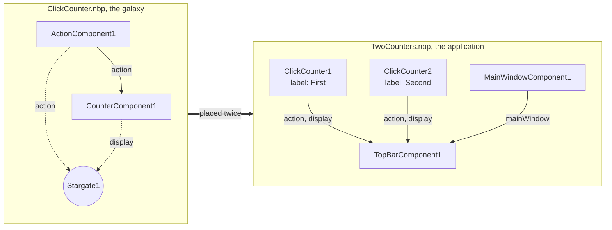

# Lesson 4 · Reuse a part

*[The course](Course.md) › Lesson 4*

A button and its counter go together. To have two of them, or ten, you do not place and link them again each time:
you make them once, in a file of their own, and place that file as a single box. Such a file is a **galaxy**.

**You need**: [lesson 2](Course-2-Assemble-Without-Code.md) done. NebulaStudio is started, and `WidgetsPlugin` is
loaded (**Plugins** tab, click `WidgetsPlugin`, click **Load**).

## What you will make

- A **galaxy** is a project file placed in another project, as one box.
- From the outside, a galaxy only has what its **stargate** shows: the stargate is the door of the galaxy. Here it
  shows the button (`action`), the count (`display`), and the text of the button, under the name `label`.

## Exercise 4.1 · Make the part

**Goal**: a new project with a button linked to a counter.

**Steps**

1. Open the menu **File** and choose **New**. If NebulaStudio asks whether to save, answer as you wish.

   *You should see:* an empty edition zone.

2. From the **Components** tab, drop an `ActionComponent`, then a `CounterComponent` on its right.

   *You should see:* `ActionComponent1` and `CounterComponent1`, the second with an amber mark.

3. Drag from the disc of `action`, in `ActionComponent1`, to the circle of `action*`, in `CounterComponent1`.

   *You should see:* a line, and no amber mark.

## Exercise 4.2 · Say what the part offers, with a stargate

**Goal**: a stargate that shows the outside the button, the count, and the text of the button.

**Steps**

1. Right-click an empty place of the edition zone, on the right of the two boxes, and choose **Add stargate**.

   *You should see:* a dialog titled **Stargate Stargate1**. Under the title **Interfaces and properties**, a list
   with four columns, **Interface or property**, **Type**, **Exposed as** and **Exposed by**, and a row for each of
   your two instances, with what it has under it.

2. Under `ActionComponent1`, check the box of the row `action`, whose **Type** is `provides QAction`.

   *You should see:* the column **Exposed as** of that row now says `action`: the name the outside will see.

3. Under `CounterComponent1`, check the box of the row `display`, whose **Type** is `provides QWidget`.

   *You should see:* **Exposed as** says `display`.

4. Under `ActionComponent1`, double-click the row `text`.

   *You should see:* its box is checked, and its name in **Exposed as**, `text`, can be typed over.

5. Type `label`, then press Enter.

   *You should see:* **Exposed as** says `label`, and the text at the right of **Interfaces and properties** says `3
   of` a number, then `exposed`.

6. Click **OK**.

   *You should see:* a box `Stargate1` in the edition zone, with two rows, `action` and `display`, each linked by a
   line to the instance it comes from, a row `label` under them, and a dashed line to `ActionComponent1`.

**If it does not work**

- *You checked `action` under `CounterComponent1` instead*: that one is what the counter **consumes**, its type says
  `consumes QAction`. Uncheck it, and check the one under `ActionComponent1`.
- ***OK** is grey, and an amber text speaks of a name*: a checked row has no name in **Exposed as**. Double-click it
  and type one.
- *You closed the dialog too early*: double-click the box `Stargate1`, below its name, to open it again.

## Exercise 4.3 · Describe it and save it

**Steps**

1. Open the menu **File** and choose **Description...**.

   *You should see:* a dialog, **Edit description**.

2. Type `A button and the count of its clicks`, then click **OK**.
3. Open the menu **File**, choose **Save As...**, type `ClickCounter` as the file name, in the folder `scene` that is
   proposed, and click **Save**.
4. Click the **Galaxies** tab.

   *You should see:* a row `ClickCounter`, whose **State** is `Loadable`. Click it: the viewer shows its description.
   `Counters` is listed too: any project of this folder is a galaxy.

## Exercise 4.4 · Place it twice

**Goal**: a window whose bar has two buttons, each with its own count.

**Steps**

1. **File** > **New**.
2. From the **Components** tab, drop a `MainWindowComponent` and a `TopBarComponent`, then drag from the disc of
   `mainWindow`, in the first, to the circle of `mainWindow*`, in the second.
3. Click the **Galaxies** tab. Drag the row `ClickCounter` to the edition zone, under the two boxes.

   *You should see:* one box, `ClickCounter1`, with the icon of a galaxy before `ClickCounter` under its name, and
   two rows with a disc on the right edge: `action` and `display`. What is inside is not shown: only what the
   stargate exposes.

4. Drag the row `ClickCounter` to the edition zone once more.

   *You should see:* a second box, `ClickCounter2`.

5. Link each galaxy to the bar. Four links:

   | Drag from the disc of | To the stacked circles of |
   | --- | --- |
   | `action`, in `ClickCounter1` | `actions`, in `TopBarComponent1` |
   | `display`, in `ClickCounter1` | `widgets`, in `TopBarComponent1` |
   | `action`, in `ClickCounter2` | `actions`, in `TopBarComponent1` |
   | `display`, in `ClickCounter2` | `widgets`, in `TopBarComponent1` |

6. Click the box `ClickCounter1`.

   *You should see:* its properties have a single row, `label`, whose value is `Action`: the property its stargate
   exposes.

7. Click that value, type `First`, press Enter. Then click `ClickCounter2` and set its `label` to `Second`.
8. **Run** > **Start**.

   *You should see:* a window whose bar has two buttons, **First** and **Second**, and two texts, `Triggered 0
   times` twice. Click **First** once and **Second** twice: `Triggered 1 times` and `Triggered 2 times`. Each
   galaxy counts its own clicks.

9. **Run** > **Stop**, then **File** > **Save As...**, `TwoCounters`.

**Check**: the edition zone has four boxes, and two of them come from one file.

## Exercise 4.5 · Change both at once

What is inside a galaxy is edited through any of its boxes, and saved to its file: every box made from that file
then changes.

**Goal**: both counters say `1 clicks`, `2 clicks`... instead of `Triggered 1 times`.

**Steps**

1. Double-click the box `ClickCounter1`, **below its name**, on the word `ClickCounter` or on its rows.

   *You should see:* the edition zone now shows the inside of the galaxy: `ActionComponent1`, `CounterComponent1`
   and `Stargate1`. Above it, a path, **Application** › `ClickCounter1`, and a button **Save Galaxy**.

2. Click the box `CounterComponent1`. In its properties, set `text` to `%1 clicks`.
3. Click **Save Galaxy**, at the end of the path, or press Ctrl+Alt+S.

   *You should see:* the status bar says `ClickCounter1 is saved: its instances have what it holds now`.

4. Click **Application**, at the start of the path.

   *You should see:* your four boxes again.

5. **Run** > **Start**, click **First** and **Second**.

   *You should see:* `1 clicks` for each: both changed. And each button kept its own name, **First** and **Second**:
   that value belongs to each box, not to the file.

6. **Run** > **Stop**, then **File** > **Save**.

**If it does not work**

- *Double-clicking renames the box instead of opening it*: you double-clicked its name, at the very top. Press Escape,
  and double-click lower.
- *You left the galaxy without saving, and a question appeared*: **Save** does what **Save Galaxy** does, **Discard**
  forgets your change, **Cancel** stays in the galaxy.

## Your turn

Have each counter keep its count from one run to the next, as in lesson 3. The settings file is added **inside** the
galaxy, so that every box gets one.

Solution

1. Double-click `ClickCounter1` below its name, to go inside.
2. Right-click an empty place and choose **Add settings file**. The dialog says, under its title, that each instance
   of the galaxy writes its own file, `ClickCounter1.settings.json` for this one.
3. Under `CounterComponent1`, check `count`. Click **OK**.
4. Click **Save Galaxy**, then **Application** in the path.
5. **Run** > **Start**, click **First** once and **Second** three times, **Run** > **Stop**.
6. **Run** > **Start**: `1 clicks` and `3 clicks` at once. **Run** > **Stop**.

Each box has its own settings file, named after it: `ClickCounter1.settings.json` and `ClickCounter2.settings.json`.
To see one, go inside the galaxy and click its sheet.

## What you learned

- A galaxy is a project file placed in another one as one box, as many times as needed.
- A stargate says what the galaxy has from the outside: interfaces, and properties under a name you choose.
- Each box has its own values for the properties exposed; the rest belongs to the file, and changes for all with
  **Save Galaxy**.

**Next**: [Lesson 5 · Your first component](Course-5-Your-First-Component.md), where the code starts.
