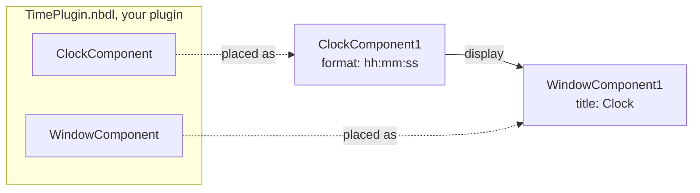

# Lesson 5 · Your first component

*[The course](Course.md) › Lesson 5*

Until now you assembled components that came with Nebula. Here you write your own: a clock, then a window that
shows it. They live in a **plugin** of yours, `TimePlugin`, which NebulaStudio loads as it loaded `WidgetsPlugin`.

**You need**: lessons [1](Course-1-Get-Ready.md) and [2](Course-2-Assemble-Without-Code.md) done, and to read a little
C++: classes, functions, `#include`. The course tells what is specific to Nebula and to Qt.

## What you will make



Your project, at the end of the lesson:

```text
C:\work\Acme\
├── CMakeLists.txt              the project: where Nebula and Qt are, which folders to build
└── TimePlugin\
    ├── CMakeLists.txt          the plugin: its name, what it links
    └── src\
        ├── ClockComponent.h    a component is a C++ class: its declaration...
        ├── ClockComponent.cpp  ...and its code
        ├── WindowComponent.h
        └── WindowComponent.cpp
```

## Exercise 5.1 · Install the tools

A plugin is built with the same compiler and the same Qt as the Nebula that loads it. Nebula 3.0.0 is built with
Visual Studio 2026 and Qt 6.12.

**Goal**: Visual Studio, Qt and CMake installed.

**Steps**

1. **Visual Studio 2026.** Download **Visual Studio Community 2026** from <https://visualstudio.microsoft.com/> and
   run its installer. On the page **Workloads**, check **Desktop development with C++**, then click **Install**.

   *You should see:* after a while, Visual Studio in the Start menu. You do not need to open it: the course only
   uses its compiler.

2. **Qt 6.12.** Download the **Qt Online Installer** from <https://www.qt.io/download-qt-installer-oss>, run it, and
   sign in with a Qt account, free to create. Keep `C:\Qt` as the folder. On the page of the components, open **Qt**,
   then **Qt 6.12.0**, and check **MSVC 2022 64-bit** only. Finish the installation.

   *You should see:* the folder `C:\Qt\6.12.0\msvc2022_64`. The name says 2022: it is the right one for Visual
   Studio 2026 too.

3. **CMake.** Download the **Windows x64 Installer** of CMake 4.2 or later from <https://cmake.org/download/> and run
   it. When it asks, choose **Add CMake to the PATH environment variable**.
4. Open a **new** terminal: Windows key, type `PowerShell`, Enter. Type:

   ```powershell
   cmake --version
   ```

   *You should see:* `cmake version 4.2` or more.

5. In the same terminal:

   ```powershell
   Test-Path C:\Qt\6.12.0\msvc2022_64\bin\Qt6Core.dll, C:\Nebula\NebulaConfig.cmake
   ```

   *You should see:* `True` twice.

**If it does not work**

- *`cmake` is not recognized*: the terminal was open before CMake was installed. Close it and open a new one.
- *The first `False`*: Qt is elsewhere, or in another version. Look in `C:\Qt`: use the folder you find wherever the
  course says `C:\Qt\6.12.0\msvc2022_64`. It has to be a 6.12.
- *The second `False`*: Nebula is not in `C:\Nebula`, see [lesson 1](Course-1-Get-Ready.md).

## Exercise 5.2 · Make the project

**Goal**: a project that builds a plugin, empty for now.

You can write the files with any text editor: the Notepad is enough, Visual Studio Code is more comfortable. Save
them as plain text, with exactly the names given.

**Steps**

1. Make the folders. In the terminal:

   ```powershell
   New-Item -ItemType Directory -Force C:\work\Acme\TimePlugin\src
   ```

   *You should see:* the folder `C:\work\Acme\TimePlugin\src` exists.

2. Create the file `C:\work\Acme\CMakeLists.txt` with this content:

   ```cmake
   # Acme/CMakeLists.txt (complete)
   cmake_minimum_required(VERSION 3.21)
   project(Acme VERSION 1.0.0 LANGUAGES CXX)

   # The first part of the ids of your plugins: AcmeCorp.Acme.TimePlugin
   set(cmu_organization "AcmeCorp")

   find_package(Nebula 3.0 REQUIRED COMPONENTS Core)
   find_package(Qt6 REQUIRED COMPONENTS Widgets)

   # Executables in <build>/bin, plugins in <build>/bin/plugins
   set(CMAKE_RUNTIME_OUTPUT_DIRECTORY "${CMAKE_BINARY_DIR}/bin")

   add_subdirectory(TimePlugin)
   ```

   What it says: the project is named `Acme`; it needs Nebula 3.0 and the Widgets of Qt; what it builds is in the
   folder `TimePlugin`.

3. Create the file `C:\work\Acme\TimePlugin\CMakeLists.txt` with this content:

   ```cmake
   # Acme/TimePlugin/CMakeLists.txt (complete)
   nebula_add_plugin(
       NAME TimePlugin
       DESCRIPTION "A clock, and a window to show it"
       LINK_LIBRARIES PRIVATE Qt6::Widgets
   )
   ```

   What it says: build a plugin named `TimePlugin`, from every source file of the folder `src` next to this file.
   You never list the source files: a new file in `src` is built by itself.

**Check**: two files named `CMakeLists.txt`, one in `C:\work\Acme`, one in `C:\work\Acme\TimePlugin`. Not
`CMakeLists.txt.txt`: in the File Explorer, **View** > **Show** > **File name extensions** shows the real names.

## Exercise 5.3 · Write a component: the clock

A component is a C++ class. `ClockComponent` shows the time in a text, and offers that text to the other instances,
as an interface named `display`.

**Goal**: the two files of `ClockComponent`.

**Steps**

1. Create the file `C:\work\Acme\TimePlugin\src\ClockComponent.h` with this content:

   ```cpp
   // Acme/TimePlugin/src/ClockComponent.h (complete)
   #pragma once

   #include <QLabel>
   #include <QString>
   #include <QTimer>

   #include "Nebula/Component/Component.h"

   // Shows the time in a label it provides as "display", refreshed every second while it runs.
   class ClockComponent : public Nebula::Component
   {
       Q_OBJECT
       Q_CLASSINFO("description", "Shows the time, refreshed while it runs")
       Q_CLASSINFO("category", "Time")
       Q_PROPERTY(QString format READ format WRITE setFormat NOTIFY formatChanged)

     public:
       ClockComponent();

       [[nodiscard]] QString format() const;
       void setFormat(const QString& format);

     signals:
       void formatChanged(const QString& format);

     protected:
       bool onStart() override;
       void onStop() override;

     private:
       void showTime();

       QLabel m_display;
       QTimer m_timer;
       QString m_format = QStringLiteral("hh:mm:ss");
   };
   ```

   Line by line, what matters:

   | Line | What it does |
   | --- | --- |
   | `class ClockComponent : public Nebula::Component` | Every component derives from `Nebula::Component` |
   | `Q_OBJECT` | Needed by Qt in every class that has properties or signals. Never forget it |
   | `Q_CLASSINFO("description", ...)` and `("category", ...)` | What the **Components** tab of NebulaStudio shows |
   | `Q_PROPERTY(QString format READ format WRITE setFormat NOTIFY formatChanged)` | A property named `format`: read with `format()`, written with `setFormat()`, and `formatChanged` tells when it changes. NebulaStudio edits it, a project saves it |
   | `bool onStart()` and `void onStop()` | Called by Nebula when the application starts and stops |
   | `QLabel m_display;` and `QTimer m_timer;` | What the clock is made of: a text, and a timer. They are created with it |

2. Create the file `C:\work\Acme\TimePlugin\src\ClockComponent.cpp` with this content:

   ```cpp
   // Acme/TimePlugin/src/ClockComponent.cpp (complete)
   #include "ClockComponent.h"

   #include <QTime>

   #include "TimePlugin.h" // Written for you by nebula_add_plugin(NAME TimePlugin)

   NEBULA_REGISTER_COMPONENT(TimePlugin, ClockComponent);

   ClockComponent::ClockComponent()
   {
       m_display.setAlignment(Qt::AlignCenter);
       showTime();
       m_timer.setInterval(1000);
       connect(&m_timer, &QTimer::timeout, this, &ClockComponent::showTime);
       provideInterface<QWidget>(QStringLiteral("display"), &m_display);
   }

   QString ClockComponent::format() const
   {
       return m_format;
   }

   void ClockComponent::setFormat(const QString& format)
   {
       if(m_format == format)
       {
           return;
       }
       m_format = format;
       showTime();
       emit formatChanged(m_format);
   }

   bool ClockComponent::onStart()
   {
       showTime();
       m_timer.start();
       return true;
   }

   void ClockComponent::onStop()
   {
       m_timer.stop();
   }

   void ClockComponent::showTime()
   {
       m_display.setText(QTime::currentTime().toString(m_format));
   }
   ```

   | Line | What it does |
   | --- | --- |
   | `#include "TimePlugin.h"` | A file you do not write: building the plugin writes it. It holds the class of the plugin |
   | `NEBULA_REGISTER_COMPONENT(TimePlugin, ClockComponent);` | Adds the component to the plugin. Without this line, NebulaStudio does not list it |
   | `connect(&m_timer, &QTimer::timeout, this, &ClockComponent::showTime);` | Qt: each time the timer ticks, call `showTime()` |
   | `provideInterface<QWidget>(QStringLiteral("display"), &m_display);` | **Provides** the text to the other instances, under the name `display`, as a `QWidget`: the disc on the right edge of the box |
   | `setFormat()` | The usual shape of a setter: do nothing when the value is the same, else keep it, apply it, and `emit` the signal |
   | `onStart()` | Starts the timer, and returns `true`: the clock accepts to start |

**Check**: `C:\work\Acme\TimePlugin\src` holds `ClockComponent.h` and `ClockComponent.cpp`.

## Exercise 5.4 · Build the plugin

Building is done in two commands. The first, **configure**, is done once: it finds Nebula and Qt and prepares a
`build` folder. The second, **build**, is done each time the code changes.

**Steps**

1. Configure. In the terminal, on one line:

   ```powershell
   cmake -S C:/work/Acme -B C:/work/Acme/build "-DCMAKE_PREFIX_PATH=C:/Nebula;C:/Qt/6.12.0/msvc2022_64"
   ```

   *You should see:* many lines, and at the end `-- Build files have been written to: C:/work/Acme/build`.

2. Build:

   ```powershell
   cmake --build C:/work/Acme/build --config Release
   ```

   *You should see:* near the end, a line that ends with `bin\Release\plugins\TimePlugin.nbdl`. That file is your
   plugin.

**Check**

```powershell
Test-Path C:\work\Acme\build\bin\Release\plugins\TimePlugin.nbdl
```

*You should see:* `True`.

**If it does not work**

- *`Could not find a package configuration file provided by "Nebula"`*: the path of Nebula in the first command is
  wrong. `C:/Nebula/NebulaConfig.cmake` must exist. Correct the command and run it again.
- *`Could not find a package configuration file provided by "Qt6"`*: the same, for the path of Qt.
- *`could not find any instance of Visual Studio`*, or no compiler: the workload **Desktop development with C++** is
  missing. Run the Visual Studio Installer again, **Modify**, check it.
- *An error with `ClockComponent.h` or `.cpp` and a line number*: a typing mistake at that line. Compare with the
  listing above. A forgotten `;` is reported on the line after it.
- *`unresolved external symbol` with `metaObject` or `staticMetaObject`*: `Q_OBJECT` is missing in the class.
- *To start from a clean state*: delete the folder `C:\work\Acme\build`, and run both commands again.

## Exercise 5.5 · See your component in NebulaStudio

NebulaStudio lists the plugins of the folders you give it with `--plugin-dir`.

**Steps**

1. Close NebulaStudio if it is open.
2. In the terminal:

   ```powershell
   & "C:\Nebula\NebulaStudio\Release\bin\NebulaStudio.exe" --plugin-dir C:\work\Acme\build\bin\Release\plugins
   ```

   *You should see:* NebulaStudio starts.

3. Click the **Plugins** tab.

   *You should see:* a fifth row, `TimePlugin`, version `1.0.0`, `Not loaded`.

4. Click `TimePlugin`, then **Load**. Then load `WidgetsPlugin` the same way: you borrow its window for a moment.
5. Click the **Components** tab.

   *You should see:* `ClockComponent`, in the category `Time`, whose plugin is `TimePlugin`. Click it: the viewer
   shows your description and your property, `format`.

6. Drop a `ClockComponent` and a `MainWindowComponent` in the edition zone.

   *You should see:* `ClockComponent1`, with a row `display` and a disc on its right edge: the interface you
   provided.

7. Drag from the disc of `display`, in `ClockComponent1`, to the circle of `centralWidget`, in `MainWindowComponent1`.
8. **Run** > **Start**.

   *You should see:* a window with the time in its middle, which changes every second.

9. **Run** > **Stop**. Click `ClockComponent1`, set its property `format` to `hh:mm`, then **Run** > **Start** again.

   *You should see:* the time without the seconds. **Run** > **Stop**.

**If it does not work**

- *No row `TimePlugin`*: the path after `--plugin-dir` is not the folder that holds `TimePlugin.nbdl`.
- *`TimePlugin` is listed, but no `ClockComponent`*: you did not click **Load**, or the line
  `NEBULA_REGISTER_COMPONENT` is missing in `ClockComponent.cpp`.

## Exercise 5.6 · A second component, which consumes: the window

The clock **provides** an interface. `WindowComponent` **consumes** one: it is a window that shows the widget it is
given, under the name `content`.

**Goal**: your own window, in place of the one of `WidgetsPlugin`.

**Steps**

1. Create the file `C:\work\Acme\TimePlugin\src\WindowComponent.h` with this content:

   ```cpp
   // Acme/TimePlugin/src/WindowComponent.h (complete)
   #pragma once

   #include <QMainWindow>
   #include <QString>

   #include "Nebula/Component/Component.h"

   // A window showing the widget it consumes as "content", which it cannot do without, while it runs.
   class WindowComponent : public Nebula::Component
   {
       Q_OBJECT
       Q_CLASSINFO("description", "A window showing a widget while it runs")
       Q_CLASSINFO("category", "Time")
       Q_PROPERTY(QString title READ title WRITE setTitle NOTIFY titleChanged)

     public:
       WindowComponent();

       [[nodiscard]] QString title() const;
       void setTitle(const QString& title);

     signals:
       void titleChanged(const QString& title);

     protected:
       bool onStart() override;
       void onStop() override;

     private:
       void showContent();
       void giveBackContent();

       QMainWindow m_window;
       QWidget* m_content = nullptr; // Consumed: written by Nebula
   };
   ```

   The new thing is the last line: `m_content` is a pointer that **Nebula** fills, once the interface is linked.
   Until then it is `nullptr`.

2. Create the file `C:\work\Acme\TimePlugin\src\WindowComponent.cpp` with this content:

   ```cpp
   // Acme/TimePlugin/src/WindowComponent.cpp (complete)
   #include "WindowComponent.h"

   #include "TimePlugin.h"

   NEBULA_REGISTER_COMPONENT(TimePlugin, WindowComponent);

   WindowComponent::WindowComponent()
   {
       m_window.setWindowTitle(QStringLiteral("Clock"));
       consumeInterface<QWidget>(
           QStringLiteral("content"), m_content, Nebula::InterfaceRequirement::Mandatory,
           [this] { showContent(); },      // m_content is set
           [this] { giveBackContent(); }); // m_content is about to be set back to nullptr
   }

   QString WindowComponent::title() const
   {
       return m_window.windowTitle();
   }

   void WindowComponent::setTitle(const QString& title)
   {
       if(m_window.windowTitle() == title)
       {
           return;
       }
       m_window.setWindowTitle(title);
       emit titleChanged(title);
   }

   bool WindowComponent::onStart()
   {
       m_window.show();
       return true;
   }

   void WindowComponent::onStop()
   {
       m_window.hide();
   }

   void WindowComponent::showContent()
   {
       m_window.setCentralWidget(m_content);
       m_content->show(); // Hidden when it was taken from another window
   }

   void WindowComponent::giveBackContent()
   {
       m_window.takeCentralWidget();
       m_content->setParent(nullptr); // It belongs to the component that provides it: the window would delete it
   }
   ```

   `consumeInterface<QWidget>(...)` has five parts:

   | Part | What it says |
   | --- | --- |
   | `QStringLiteral("content")` | The name of the interface: the row of the box |
   | `m_content` | The pointer Nebula fills |
   | `Nebula::InterfaceRequirement::Mandatory` | The window does not work without it: the star, and the amber mark |
   | `[this] { showContent(); }` | Called once `m_content` is set: put the widget in the window |
   | `[this] { giveBackContent(); }` | Called just before `m_content` goes: take the widget out, and let it go |

   The widget belongs to the clock, not to the window. That is why `giveBackContent()` gives it back without a
   parent: otherwise the window would delete it with itself.

3. **Close NebulaStudio.** While it is open, it holds `TimePlugin.nbdl`, and the build cannot replace it.
4. Build:

   ```powershell
   cmake --build C:/work/Acme/build --config Release
   ```

   *You should see:* the line that ends with `TimePlugin.nbdl` again.

5. Start NebulaStudio as in exercise 5.5, and load `TimePlugin`.

   *You should see:* in the **Components** tab, `ClockComponent` and `WindowComponent`.

6. Drop a `ClockComponent` and a `WindowComponent`.

   *You should see:* `WindowComponent1` has a row `content*`, a circle on its left edge, and the amber mark.

7. Drag from the disc of `display`, in `ClockComponent1`, to the circle of `content*`, in `WindowComponent1`.
8. **Run** > **Start**.

   *You should see:* a window titled `Clock`, with the time. **Run** > **Stop**.

9. **File** > **Save As...**. In the dialog, go to `C:\work\Acme`, type `Clock` as the file name, click **Save**.

**Check**: `C:\work\Acme\Clock.nbp` exists. From now on, start NebulaStudio with this project, which loads your
plugin by itself:

```powershell
& "C:\Nebula\NebulaStudio\Release\bin\NebulaStudio.exe" --plugin-dir C:\work\Acme\build\bin\Release\plugins C:\work\Acme\Clock.nbp
```

**If it does not work**

- *The build ends with `cannot open file ... TimePlugin.nbdl`*, or `LNK1104`: NebulaStudio is still open. Close it,
  build again.
- *NebulaStudio still shows the old plugin*: it was not closed between the two builds. Close it and start it again.

## The loop you will repeat

Every change of code, in the next lessons, goes through the same four steps:

1. Change the code, save the files.
2. **Close NebulaStudio.**
3. `cmake --build C:/work/Acme/build --config Release`
4. Start NebulaStudio with the command above.

## Your turn

Give the window a property `width`, a number of pixels, 400 at first, that sets how wide it is when it opens.

What you need to know: a property of type `int` is declared as `format` is, with `int` in place of `QString`. A
`QMainWindow` is resized with `resize(width, height)`, and its height is `height()`.

<details>
<summary>Solution</summary>

In `WindowComponent.h`, under the line of the property `title`:

```cpp
    Q_PROPERTY(int width READ width WRITE setWidth NOTIFY widthChanged)
```

under `void setTitle(const QString& title);`:

```cpp
    [[nodiscard]] int width() const;
    void setWidth(int width);
```

under `void titleChanged(const QString& title);`:

```cpp
    void widthChanged(int width);
```

and under `QWidget* m_content = nullptr;`:

```cpp
    int m_width = 400;
```

In `WindowComponent.cpp`, anywhere after the constructor:

```cpp
int WindowComponent::width() const
{
    return m_width;
}

void WindowComponent::setWidth(int width)
{
    if(m_width == width)
    {
        return;
    }
    m_width = width;
    emit widthChanged(m_width);
}
```

and in `onStart()`, before `m_window.show();`:

```cpp
    m_window.resize(m_width, m_window.height());
```

Close NebulaStudio, build, start it: `WindowComponent1` has a property `width`. The rest of the course does not use
it: keep it or remove it.

</details>

## What you learned

- A plugin is a small CMake project; `nebula_add_plugin()` builds every file of its `src` folder.
- A component is a class that derives from `Nebula::Component`, with `Q_OBJECT`, registered with
  `NEBULA_REGISTER_COMPONENT`.
- `provideInterface<T>(name, pointer)` offers something; `consumeInterface<T>(name, member, ...)` asks for something,
  which Nebula writes in the member.
- NebulaStudio must be closed while the plugin is built.

**Next**: [Lesson 6 · Properties and modes](Course-6-Properties-and-Modes.md)
