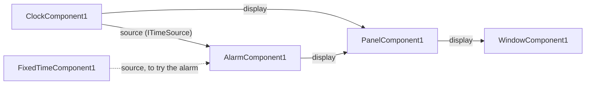

# Lesson 7 · Interfaces of your own

*[The course](Course.md) › Lesson 7*

So far your components exchanged a `QWidget`, a type of Qt. Here you write an interface of your own: a small class
that says what one component offers another. With it you make an alarm that asks "what time is it?" without knowing
who answers, then a panel that shows several widgets.

**You need**: [lesson 6](Course-6-Properties-and-Modes.md) done.

## What you will make



Three new components, and a new file for the interface. All new files go in `C:\work\Acme\TimePlugin\src`.

## Exercise 7.1 · Write the interface

An interface is a class with functions that have no code: it says what can be asked, not how it is answered.

**Steps**

1. Create the file `C:\work\Acme\TimePlugin\src\ITimeSource.h` with this content:

   ```cpp
   // Acme/TimePlugin/src/ITimeSource.h (complete)
   #pragma once

   #include <QTime>

   // What tells the time: a clock, or anything that stands in for one.
   class ITimeSource
   {
     public:
       virtual ~ITimeSource() = default;

       [[nodiscard]] virtual QTime time() const = 0;
   };
   ```

   One question can be asked of an `ITimeSource`: `time()`. The `= 0` says that this class does not answer it: the
   classes that derive from it do.

## Exercise 7.2 · Have the clock provide it

**Goal**: the clock offers a second interface, `source`, an `ITimeSource` that tells the time of the computer.

**Steps**

1. In `ClockComponent.h`, under the line `#include <QTimer>`, add:

   ```cpp

   #include "ITimeSource.h"
   ```

2. In `ClockComponent.h`, just above the comment line that precedes `class ClockComponent`, add a small class that
   answers the question:

   ```cpp
   // The time of the computer.
   class SystemTime : public ITimeSource
   {
     public:
       [[nodiscard]] QTime time() const override { return QTime::currentTime(); }
   };

   ```

3. In `ClockComponent.h`, under the line `Style m_style = Style::Plain;`, add:

   ```cpp
       SystemTime m_time;
   ```

   The clock is now made of three things: a text, a timer, and a time source.

4. In `ClockComponent.cpp`, in the constructor, under the line `provideInterface<QWidget>(...)`, add:

   ```cpp
       provideInterface<ITimeSource>(QStringLiteral("source"), &m_time);
   ```

5. In `ClockComponent.cpp`, in `showTime()`, replace `QTime::currentTime()` with `m_time.time()`:

   ```cpp
       m_display.setText(m_time.time().toString(m_format));
   ```

   and remove the line `#include <QTime>` at the top of the file: `ITimeSource.h` brings it.

<details>
<summary>ClockComponent.h, after this exercise</summary>

```cpp
// Acme/TimePlugin/src/ClockComponent.h (complete)
#pragma once

#include <QLabel>
#include <QString>
#include <QTimer>

#include "ITimeSource.h"
#include "Nebula/Component/Component.h"

// The time of the computer.
class SystemTime : public ITimeSource
{
  public:
    [[nodiscard]] QTime time() const override { return QTime::currentTime(); }
};

// Shows the time in a label it provides as "display", refreshed while it runs, and tells it as "source".
class ClockComponent : public Nebula::Component
{
    Q_OBJECT
    Q_CLASSINFO("description", "Shows the time, refreshed while it runs")
    Q_CLASSINFO("category", "Time")
    Q_PROPERTY(QString format READ format WRITE setFormat NOTIFY formatChanged)
    Q_PROPERTY(int interval READ interval WRITE setInterval NOTIFY intervalChanged)
    Q_PROPERTY(Style style READ style WRITE setStyle NOTIFY styleChanged)

  public:
    enum class Style
    {
        Plain,
        Bold,
        Large,
    };
    Q_ENUM(Style)

    ClockComponent();

    [[nodiscard]] QString format() const;
    void setFormat(const QString& format);
    [[nodiscard]] int interval() const;
    void setInterval(int interval);
    [[nodiscard]] Style style() const;
    void setStyle(Style style);

  signals:
    void formatChanged(const QString& format);
    void intervalChanged(int interval);
    void styleChanged(ClockComponent::Style style);

  protected:
    bool onStart() override;
    void onStop() override;

  private:
    void showTime();
    void applyStyle();

    QLabel m_display;
    QTimer m_timer;
    QString m_format = QStringLiteral("hh:mm:ss");
    Style m_style = Style::Plain;
    SystemTime m_time;
};
```

</details>

<details>
<summary>ClockComponent.cpp, after this exercise</summary>

```cpp
// Acme/TimePlugin/src/ClockComponent.cpp (complete)
#include "ClockComponent.h"

#include "TimePlugin.h" // Written for you by nebula_add_plugin(NAME TimePlugin)

NEBULA_REGISTER_COMPONENT(TimePlugin, ClockComponent);

ClockComponent::ClockComponent()
{
    m_display.setAlignment(Qt::AlignCenter);
    showTime();
    m_timer.setInterval(1000);
    connect(&m_timer, &QTimer::timeout, this, &ClockComponent::showTime);
    provideInterface<QWidget>(QStringLiteral("display"), &m_display);
    provideInterface<ITimeSource>(QStringLiteral("source"), &m_time);
}

QString ClockComponent::format() const
{
    return m_format;
}

void ClockComponent::setFormat(const QString& format)
{
    if(m_format == format)
    {
        return;
    }
    m_format = format;
    showTime();
    emit formatChanged(m_format);
}

int ClockComponent::interval() const
{
    return m_timer.interval();
}

void ClockComponent::setInterval(int interval)
{
    if(interval <= 0 || m_timer.interval() == interval)
    {
        return; // A timer of 0 ms would refresh the label as fast as it can
    }
    m_timer.setInterval(interval); // Applied at once, even while it runs
    emit intervalChanged(interval);
}

ClockComponent::Style ClockComponent::style() const
{
    return m_style;
}

void ClockComponent::setStyle(Style style)
{
    if(m_style == style)
    {
        return;
    }
    m_style = style;
    applyStyle();
    emit styleChanged(m_style);
}

bool ClockComponent::onStart()
{
    if(m_format.isEmpty())
    {
        return false; // Refused: the application stops what it started
    }
    showTime();
    m_timer.start();
    return true;
}

void ClockComponent::onStop()
{
    m_timer.stop();
}

void ClockComponent::showTime()
{
    m_display.setText(m_time.time().toString(m_format));
}

void ClockComponent::applyStyle()
{
    QFont font = m_display.font();
    font.setBold(m_style != Style::Plain);
    font.setPointSize(m_style == Style::Large ? 28 : 11);
    m_display.setFont(font);
}
```

</details>

## Exercise 7.3 · An alarm that consumes it

**Goal**: `AlarmComponent`. It has an `alarm` time, 07:30 at first, and consumes a `source`. While it runs, it asks
the source the time every second; when the hour and the minute are those of the alarm, it shows `Ringing!`.
Otherwise it shows `Alarm at 07:30`.

**Steps**

1. Create the file `C:\work\Acme\TimePlugin\src\AlarmComponent.h` with this content:

   ```cpp
   // Acme/TimePlugin/src/AlarmComponent.h (complete)
   #pragma once

   #include <QLabel>
   #include <QTime>
   #include <QTimer>

   #include "ITimeSource.h"
   #include "Nebula/Component/Component.h"

   // Rings once the time its "source" tells reaches its alarm, while it runs, and shows it in its "display".
   class AlarmComponent : public Nebula::Component
   {
       Q_OBJECT
       Q_CLASSINFO("description", "Rings once the time it is given reaches its alarm")
       Q_CLASSINFO("category", "Time")
       Q_PROPERTY(QTime alarm READ alarm WRITE setAlarm NOTIFY alarmChanged)

     public:
       AlarmComponent();

       [[nodiscard]] QTime alarm() const;
       void setAlarm(QTime alarm);

     signals:
       void alarmChanged(QTime alarm);

     protected:
       bool onStart() override;
       void onStop() override;

     private:
       void check();
       void ring();
       void showWaiting();

       QLabel m_display;
       QTimer m_timer;
       QTime m_alarm{7, 30};
       bool m_rung = false;
       ITimeSource* m_source = nullptr; // Consumed
   };
   ```

2. Create the file `C:\work\Acme\TimePlugin\src\AlarmComponent.cpp` with this content:

   ```cpp
   // Acme/TimePlugin/src/AlarmComponent.cpp (complete)
   #include "AlarmComponent.h"

   #include "TimePlugin.h"

   NEBULA_REGISTER_COMPONENT(TimePlugin, AlarmComponent);

   AlarmComponent::AlarmComponent()
   {
       m_display.setAlignment(Qt::AlignCenter);
       showWaiting();
       m_timer.setInterval(1000);
       connect(&m_timer, &QTimer::timeout, this, &AlarmComponent::check);
       provideInterface<QWidget>(QStringLiteral("display"), &m_display);
       consumeInterface<ITimeSource>(QStringLiteral("source"), m_source, Nebula::InterfaceRequirement::Mandatory);
   }

   QTime AlarmComponent::alarm() const
   {
       return m_alarm;
   }

   void AlarmComponent::setAlarm(QTime alarm)
   {
       if(m_alarm == alarm)
       {
           return;
       }
       m_alarm = alarm;
       showWaiting();
       emit alarmChanged(m_alarm);
   }

   bool AlarmComponent::onStart()
   {
       m_rung = false;
       showWaiting();
       m_timer.start();
       check(); // At once: the alarm may be due already
       return true;
   }

   void AlarmComponent::onStop()
   {
       m_timer.stop();
   }

   void AlarmComponent::check()
   {
       if(m_rung || m_source == nullptr)
       {
           return;
       }
       const QTime now = m_source->time();
       if(now.hour() == m_alarm.hour() && now.minute() == m_alarm.minute())
       {
           ring();
       }
   }

   void AlarmComponent::ring()
   {
       m_rung = true;
       m_display.setText(QStringLiteral("Ringing!"));
   }

   void AlarmComponent::showWaiting()
   {
       m_display.setText(QStringLiteral("Alarm at %1").arg(m_alarm.toString(QStringLiteral("hh:mm"))));
   }
   ```

   | Line | What it does |
   | --- | --- |
   | `consumeInterface<ITimeSource>(QStringLiteral("source"), m_source, ...Mandatory);` | Asks for an `ITimeSource` under the name `source`. No function to call here when it comes or goes: the two last parts are optional |
   | `if(m_rung \|\| m_source == nullptr)` | Always test a consumed pointer before using it: the alarm can start with nothing linked |
   | `m_source->time()` | The alarm asks the time. It does not know, and does not care, who answers |

3. Close NebulaStudio, build, start NebulaStudio with your project:

   ```powershell
   cmake --build C:/work/Acme/build --config Release
   ```

   ```powershell
   & "C:\Nebula\NebulaStudio\Release\bin\NebulaStudio.exe" --plugin-dir C:\work\Acme\build\bin\Release\plugins C:\work\Acme\Clock.nbp
   ```

   *You should see:* `ClockComponent1` now has a second disc on its right edge, `source`.

4. From the **Components** tab, drop an `AlarmComponent`.

   *You should see:* `AlarmComponent1`, with `source*` on its left edge, `display` on its right edge, and the amber
   mark.

5. Press the left button on the circle of `source*`, in `AlarmComponent1`, and move without releasing.

   *You should see:* the disc of `display`, in `ClockComponent1`, is dimmed, and its `source` is not: a `source` is
   only linked to an `ITimeSource`.

6. Release on the disc of `source`, in `ClockComponent1`.

   *You should see:* a line, and no amber mark.

The alarm is not shown anywhere yet: the window shows the clock. Exercise 7.5 shows both.

## Exercise 7.4 · A stand-in, to try the alarm now

To see the alarm ring, you would wait until 07:30. Instead, you write a second component that provides an
`ITimeSource`: one that always says the same time. The alarm will not see the difference: that is what an interface
is for.

**Steps**

1. Create the file `C:\work\Acme\TimePlugin\src\FixedTimeComponent.h` with this content:

   ```cpp
   // Acme/TimePlugin/src/FixedTimeComponent.h (complete)
   #pragma once

   #include <QTime>

   #include "ITimeSource.h"
   #include "Nebula/Component/Component.h"

   // Always the same time.
   class FixedTime : public ITimeSource
   {
     public:
       [[nodiscard]] QTime time() const override { return m_time; }
       void setTime(QTime time) { m_time = time; }

     private:
       QTime m_time{7, 30};
   };

   // Tells the same time whatever the time is, as "source": to try what depends on the time without waiting for it.
   class FixedTimeComponent : public Nebula::Component
   {
       Q_OBJECT
       Q_CLASSINFO("description", "Always tells the same time")
       Q_CLASSINFO("category", "Time")
       Q_PROPERTY(QTime time READ time WRITE setTime NOTIFY timeChanged)

     public:
       FixedTimeComponent();

       [[nodiscard]] QTime time() const;
       void setTime(QTime time);

     signals:
       void timeChanged(QTime time);

     private:
       FixedTime m_source;
   };
   ```

2. Create the file `C:\work\Acme\TimePlugin\src\FixedTimeComponent.cpp` with this content:

   ```cpp
   // Acme/TimePlugin/src/FixedTimeComponent.cpp (complete)
   #include "FixedTimeComponent.h"

   #include "TimePlugin.h"

   NEBULA_REGISTER_COMPONENT(TimePlugin, FixedTimeComponent);

   FixedTimeComponent::FixedTimeComponent()
   {
       provideInterface<ITimeSource>(QStringLiteral("source"), &m_source);
   }

   QTime FixedTimeComponent::time() const
   {
       return m_source.time();
   }

   void FixedTimeComponent::setTime(QTime time)
   {
       if(m_source.time() == time)
       {
           return;
       }
       m_source.setTime(time);
       emit timeChanged(time);
   }
   ```

   Nothing new: you have written every one of these lines before. Building it is done with the panel, in the next
   exercise.

## Exercise 7.5 · A panel, which consumes a list

A window shows one widget. To show the clock and the alarm, you write a panel that takes **several** widgets: it
consumes a **list**.

**Steps**

1. Create the file `C:\work\Acme\TimePlugin\src\PanelComponent.h` with this content:

   ```cpp
   // Acme/TimePlugin/src/PanelComponent.h (complete)
   #pragma once

   #include <QList>
   #include <QVBoxLayout>
   #include <QWidget>

   #include "Nebula/Component/Component.h"

   // Shows the widgets of its list "widgets" one above the other, in the order of their bindings, in its "display".
   class PanelComponent : public Nebula::Component
   {
       Q_OBJECT
       Q_CLASSINFO("description", "Shows the widgets it is given, one above the other")
       Q_CLASSINFO("category", "Time")

     public:
       PanelComponent();

     private:
       void place(QWidget* widget);
       void giveBack(QWidget* widget);

       QWidget m_panel;
       QVBoxLayout* m_layout = new QVBoxLayout(&m_panel); // Owned by m_panel
       QList<QWidget*> m_widgets;                         // Consumed
   };
   ```

2. Create the file `C:\work\Acme\TimePlugin\src\PanelComponent.cpp` with this content:

   ```cpp
   // Acme/TimePlugin/src/PanelComponent.cpp (complete)
   #include "PanelComponent.h"

   #include "TimePlugin.h"

   NEBULA_REGISTER_COMPONENT(TimePlugin, PanelComponent);

   PanelComponent::PanelComponent()
   {
       provideInterface<QWidget>(QStringLiteral("display"), &m_panel);
       consumeInterfaceList<QWidget>(
           QStringLiteral("widgets"), m_widgets,
           [this](QWidget* widget) { place(widget); },     // In m_widgets
           [this](QWidget* widget) { giveBack(widget); }); // About to leave m_widgets
   }

   void PanelComponent::place(QWidget* widget)
   {
       // At its rank among those available: the layout holds the same widgets, in the same order.
       m_layout->insertWidget(static_cast<int>(m_widgets.indexOf(widget)), widget);
       widget->show();
   }

   void PanelComponent::giveBack(QWidget* widget)
   {
       m_layout->removeWidget(widget);
       widget->setParent(nullptr); // It belongs to the component that provides it
   }
   ```

   | Line | What it does |
   | --- | --- |
   | `QList<QWidget*> m_widgets;` | A list in place of a single pointer: Nebula keeps in it the widgets linked, in the order of their links |
   | `consumeInterfaceList<QWidget>(name, list, onInserted, onRemoved)` | Asks for a list. The first function is called for each widget once it is in the list, the second just before it leaves |
   | `widget->setParent(nullptr);` | As in the window of lesson 5: what was borrowed is given back |

3. Close NebulaStudio, build, start NebulaStudio with your project.

   *You should see:* in the **Components** tab, five components in the category `Time`.

4. Drop a `PanelComponent` and a `FixedTimeComponent`.

   *You should see:* `PanelComponent1` has `widgets` on its left edge, drawn as **two stacked circles**, the mark of
   a list, and `display` on its right edge.

5. Change what the window shows. Click the line between `display` of `ClockComponent1` and `content*` of
   `WindowComponent1`, and press Delete. Then make these three links:

   | Drag from the disc of | To |
   | --- | --- |
   | `display`, in `ClockComponent1` | the stacked circles of `widgets`, in `PanelComponent1` |
   | `display`, in `AlarmComponent1` | the stacked circles of `widgets`, in `PanelComponent1` |
   | `display`, in `PanelComponent1` | the circle of `content*`, in `WindowComponent1` |

6. **Run** > **Start**.

   *You should see:* the window shows the time, and under it `Alarm at 07:30`. **Run** > **Stop**.

7. Now give the alarm the stand-in. Drag from the disc of `source`, in `FixedTimeComponent1`, to the circle of
   `source*`, in `AlarmComponent1`.

   *You should see:* the line from the clock to `source*` is replaced by the new one: a single interface has one
   link at a time.

8. **Run** > **Start**.

   *You should see:* the time, and under it `Ringing!` at once: for the alarm, it is 07:30. **Run** > **Stop**.

9. **File** > **Save**.

**If it does not work**

- *The alarm is above the clock*: a list keeps the order of its links, and you linked the alarm first. Remove both
  links to `widgets`, and make them again, the clock first.
- *The window is empty*: the link from the panel to `content*` is missing.

## Your turn

Have the alarm ring for real: link it to the clock again, and set its `alarm` to the next minute. Then tell what you
had to change in the code of the alarm to go from the stand-in to the clock.

<details>
<summary>Solution</summary>

1. Drag from the disc of `source`, in `ClockComponent1`, to the circle of `source*`, in `AlarmComponent1`: the link
   from `FixedTimeComponent1` is replaced.
2. Click `AlarmComponent1`, click the value of `alarm`, and set the time of the next minute.
3. **Run** > **Start**, and wait: `Ringing!` appears when the minute comes. **Run** > **Stop**.

Nothing changed in the code of the alarm. It asks an `ITimeSource` the time; which component answers is decided in
NebulaStudio, by a link. Before going on, link the alarm to `FixedTimeComponent1` again, and **File** > **Save**:
the next lessons use it.

</details>

## What you learned

- An interface of your own is a class of functions without code, in a header both sides include.
- A component provides it through a small class that answers, kept as a member.
- A consumer does not know who provides: a stand-in takes the place of the real thing with one link.
- `consumeInterfaceList` takes several links, in their order; its mark is two stacked circles.

**Next**: [Lesson 8 · Log and history](Course-8-Log-and-History.md)
