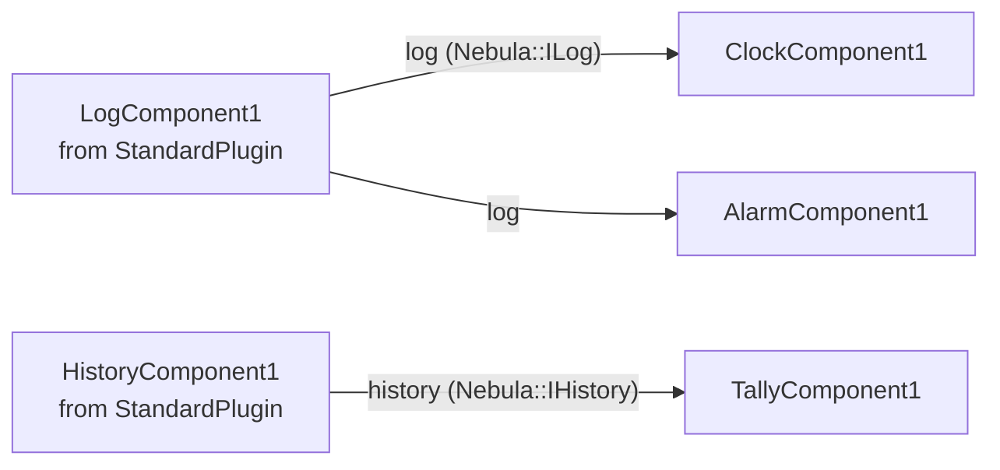

# Lesson 8 · Log and history

*[The course](Course.md) › Lesson 8*

Two things most applications need come with Nebula, ready to use, in the plugin `StandardPlugin`: a **log**, where
components write messages, and a **history**, which undoes and redoes what the user did. Your components use them
as they use each other: through interfaces.

**You need**: [lesson 7](Course-7-Interfaces-of-Your-Own.md) done.

## What you will make



| Component of `StandardPlugin` | It provides | Which is |
| --- | --- | --- |
| `LogComponent` | `log`, a `Nebula::ILog` | Something to write messages to: `info()`, `warning()`... |
| `HistoryComponent` | `history`, a `Nebula::IHistory` | Something that does an action, then can undo it and redo it |

## Exercise 8.1 · Give your plugin the interfaces of Nebula

`Nebula::ILog` and `Nebula::IHistory` are declared in headers of Nebula, grouped under the name `Nebula::Standard`.
Your project has to ask for them.

**Steps**

1. In `C:\work\Acme\CMakeLists.txt`, in the line `find_package(Nebula ...)`, add `Standard` after `Core`. The file
   becomes:

   ```cmake
   # Acme/CMakeLists.txt (complete)
   cmake_minimum_required(VERSION 3.21)
   project(Acme VERSION 1.0.0 LANGUAGES CXX)

   # The first part of the ids of your plugins: AcmeCorp.Acme.TimePlugin
   set(cmu_organization "AcmeCorp")

   find_package(Nebula 3.0 REQUIRED COMPONENTS Core Standard)
   find_package(Qt6 REQUIRED COMPONENTS Widgets)

   # Executables in <build>/bin, plugins in <build>/bin/plugins
   set(CMAKE_RUNTIME_OUTPUT_DIRECTORY "${CMAKE_BINARY_DIR}/bin")

   add_subdirectory(TimePlugin)
   ```

2. In `C:\work\Acme\TimePlugin\CMakeLists.txt`, add `Nebula::Standard` before `Qt6::Widgets`. The file becomes:

   ```cmake
   # Acme/TimePlugin/CMakeLists.txt (complete)
   nebula_add_plugin(
       NAME TimePlugin
       DESCRIPTION "A clock, and a window to show it"
       LINK_LIBRARIES PRIVATE Nebula::Standard Qt6::Widgets
   )
   ```

Nothing to run yet: the next build takes these changes by itself.

## Exercise 8.2 · Write to the log

**Goal**: the clock tells why it refuses to start, and the alarm tells when it rings.

**Steps**

1. In `ClockComponent.h`, under the line `#include "Nebula/Component/Component.h"`, add:

   ```cpp
   #include "Nebula/Standard/ILog.h"
   ```

   and under the line `SystemTime m_time;`, add:

   ```cpp
       Nebula::ILog* m_log = nullptr; // Consumed
   ```

2. In `ClockComponent.cpp`, in the constructor, under the line `provideInterface<ITimeSource>(...)`, add:

   ```cpp
       consumeInterface<Nebula::ILog>(QStringLiteral("log"), m_log);
   ```

   No `Mandatory` here: the clock works without a log. The interface is **optional**.

3. In `ClockComponent.cpp`, in `onStart()`, replace the three lines of the `if` with:

   ```cpp
       if(m_format.isEmpty())
       {
           if(m_log != nullptr)
           {
               m_log->warning(QStringLiteral("An empty format shows nothing"), objectName());
           }
           return false; // Refused: the application stops what it started
       }
   ```

   `warning(message, source)` writes a message. `objectName()` is the name of the instance, `ClockComponent1`: it
   tells who writes.

4. Do the same in the alarm. In `AlarmComponent.h`, under `#include "Nebula/Component/Component.h"`, add:

   ```cpp
   #include "Nebula/Standard/ILog.h"
   ```

   and under the line `ITimeSource* m_source = nullptr; // Consumed`, add:

   ```cpp
       Nebula::ILog* m_log = nullptr; // Consumed
   ```

5. In `AlarmComponent.cpp`, in the constructor, under the line `consumeInterface<ITimeSource>(...)`, add:

   ```cpp
       consumeInterface<Nebula::ILog>(QStringLiteral("log"), m_log);
   ```

   and replace the function `ring()` with:

   ```cpp
   void AlarmComponent::ring()
   {
       m_rung = true;
       m_display.setText(QStringLiteral("Ringing!"));
       if(m_log != nullptr)
       {
           m_log->warning(QStringLiteral("Ringing at %1").arg(m_alarm.toString(QStringLiteral("hh:mm"))), objectName());
       }
   }
   ```

6. Close NebulaStudio and build:

   ```powershell
   cmake --build C:/work/Acme/build --config Release
   ```

7. Start NebulaStudio with one more option, `--console`, which has it write the messages in the terminal:

   ```powershell
   & "C:\Nebula\NebulaStudio\Release\bin\NebulaStudio.exe" --console --plugin-dir C:\work\Acme\build\bin\Release\plugins C:\work\Acme\Clock.nbp
   ```

   *You should see:* `ClockComponent1` and `AlarmComponent1` each have a new row on their left edge, `log`, without a
   star.

8. Click the **Components** tab, and drop a `LogComponent`, whose category is `Diagnostics`.

   *You should see:* `LogComponent1`, with two discs on its right edge, `log` and `logControl`.

9. Drag from the disc of `log`, in `LogComponent1`, to the circle of `log`, in `ClockComponent1`. Then from the same
   disc to the circle of `log`, in `AlarmComponent1`.
10. **Run** > **Start**, then look at the terminal.

    *You should see:* the line `log: AlarmComponent1: Ringing at 07:30`. **Run** > **Stop**.

11. Click `ClockComponent1`, erase its `format`, **Run** > **Start**.

    *You should see:* the box that refuses to start, as in lesson 6, and this time the terminal says why:
    `log: ClockComponent1: An empty format shows nothing`. Set `format` back to `hh:mm:ss`.

12. **File** > **Save**.

**Good to know**: `LogComponent1` has a property `level`, `debug` at first: the least serious messages written,
among `debug`, `info`, `warning` and `critical`. While the log runs, it holds for every message of the application,
not only yours. Instances start in the order they were placed: a message written by an instance that starts before
the log, as your alarm does here, is not filtered yet. In an application, place the log first.

**If it does not work**

- *`Cannot open include file: 'Nebula/Standard/ILog.h'`*: exercise 8.1 is not done, or a `CMakeLists.txt` was not
  saved.
- *The terminal shows nothing*: NebulaStudio was started without `--console`, or the alarm is linked to the clock and
  it is not 07:30: link its `source*` to `FixedTimeComponent1`.

<details>
<summary>ClockComponent.h, after this exercise</summary>

```cpp
// Acme/TimePlugin/src/ClockComponent.h (complete)
#pragma once

#include <QLabel>
#include <QString>
#include <QTimer>

#include "ITimeSource.h"
#include "Nebula/Component/Component.h"
#include "Nebula/Standard/ILog.h"

// The time of the computer.
class SystemTime : public ITimeSource
{
  public:
    [[nodiscard]] QTime time() const override { return QTime::currentTime(); }
};

// Shows the time in a label it provides as "display", refreshed while it runs, and tells it as "source".
class ClockComponent : public Nebula::Component
{
    Q_OBJECT
    Q_CLASSINFO("description", "Shows the time, refreshed while it runs")
    Q_CLASSINFO("category", "Time")
    Q_PROPERTY(QString format READ format WRITE setFormat NOTIFY formatChanged)
    Q_PROPERTY(int interval READ interval WRITE setInterval NOTIFY intervalChanged)
    Q_PROPERTY(Style style READ style WRITE setStyle NOTIFY styleChanged)

  public:
    enum class Style
    {
        Plain,
        Bold,
        Large,
    };
    Q_ENUM(Style)

    ClockComponent();

    [[nodiscard]] QString format() const;
    void setFormat(const QString& format);
    [[nodiscard]] int interval() const;
    void setInterval(int interval);
    [[nodiscard]] Style style() const;
    void setStyle(Style style);

  signals:
    void formatChanged(const QString& format);
    void intervalChanged(int interval);
    void styleChanged(ClockComponent::Style style);

  protected:
    bool onStart() override;
    void onStop() override;

  private:
    void showTime();
    void applyStyle();

    QLabel m_display;
    QTimer m_timer;
    QString m_format = QStringLiteral("hh:mm:ss");
    Style m_style = Style::Plain;
    SystemTime m_time;
    Nebula::ILog* m_log = nullptr; // Consumed
};
```

</details>

<details>
<summary>ClockComponent.cpp, after this exercise</summary>

```cpp
// Acme/TimePlugin/src/ClockComponent.cpp (complete)
#include "ClockComponent.h"

#include "TimePlugin.h" // Written for you by nebula_add_plugin(NAME TimePlugin)

NEBULA_REGISTER_COMPONENT(TimePlugin, ClockComponent);

ClockComponent::ClockComponent()
{
    m_display.setAlignment(Qt::AlignCenter);
    showTime();
    m_timer.setInterval(1000);
    connect(&m_timer, &QTimer::timeout, this, &ClockComponent::showTime);
    provideInterface<QWidget>(QStringLiteral("display"), &m_display);
    provideInterface<ITimeSource>(QStringLiteral("source"), &m_time);
    consumeInterface<Nebula::ILog>(QStringLiteral("log"), m_log);
}

QString ClockComponent::format() const
{
    return m_format;
}

void ClockComponent::setFormat(const QString& format)
{
    if(m_format == format)
    {
        return;
    }
    m_format = format;
    showTime();
    emit formatChanged(m_format);
}

int ClockComponent::interval() const
{
    return m_timer.interval();
}

void ClockComponent::setInterval(int interval)
{
    if(interval <= 0 || m_timer.interval() == interval)
    {
        return; // A timer of 0 ms would refresh the label as fast as it can
    }
    m_timer.setInterval(interval); // Applied at once, even while it runs
    emit intervalChanged(interval);
}

ClockComponent::Style ClockComponent::style() const
{
    return m_style;
}

void ClockComponent::setStyle(Style style)
{
    if(m_style == style)
    {
        return;
    }
    m_style = style;
    applyStyle();
    emit styleChanged(m_style);
}

bool ClockComponent::onStart()
{
    if(m_format.isEmpty())
    {
        if(m_log != nullptr)
        {
            m_log->warning(QStringLiteral("An empty format shows nothing"), objectName());
        }
        return false; // Refused: the application stops what it started
    }
    showTime();
    m_timer.start();
    return true;
}

void ClockComponent::onStop()
{
    m_timer.stop();
}

void ClockComponent::showTime()
{
    m_display.setText(m_time.time().toString(m_format));
}

void ClockComponent::applyStyle()
{
    QFont font = m_display.font();
    font.setBold(m_style != Style::Plain);
    font.setPointSize(m_style == Style::Large ? 28 : 11);
    m_display.setFont(font);
}
```

</details>

<details>
<summary>AlarmComponent.h, after this exercise</summary>

```cpp
// Acme/TimePlugin/src/AlarmComponent.h (complete)
#pragma once

#include <QLabel>
#include <QTime>
#include <QTimer>

#include "ITimeSource.h"
#include "Nebula/Component/Component.h"
#include "Nebula/Standard/ILog.h"

// Rings once the time its "source" tells reaches its alarm, while it runs, and shows it in its "display".
class AlarmComponent : public Nebula::Component
{
    Q_OBJECT
    Q_CLASSINFO("description", "Rings once the time it is given reaches its alarm")
    Q_CLASSINFO("category", "Time")
    Q_PROPERTY(QTime alarm READ alarm WRITE setAlarm NOTIFY alarmChanged)

  public:
    AlarmComponent();

    [[nodiscard]] QTime alarm() const;
    void setAlarm(QTime alarm);

  signals:
    void alarmChanged(QTime alarm);

  protected:
    bool onStart() override;
    void onStop() override;

  private:
    void check();
    void ring();
    void showWaiting();

    QLabel m_display;
    QTimer m_timer;
    QTime m_alarm{7, 30};
    bool m_rung = false;
    ITimeSource* m_source = nullptr; // Consumed
    Nebula::ILog* m_log = nullptr;   // Consumed
};
```

</details>

<details>
<summary>AlarmComponent.cpp, after this exercise</summary>

```cpp
// Acme/TimePlugin/src/AlarmComponent.cpp (complete)
#include "AlarmComponent.h"

#include "TimePlugin.h"

NEBULA_REGISTER_COMPONENT(TimePlugin, AlarmComponent);

AlarmComponent::AlarmComponent()
{
    m_display.setAlignment(Qt::AlignCenter);
    showWaiting();
    m_timer.setInterval(1000);
    connect(&m_timer, &QTimer::timeout, this, &AlarmComponent::check);
    provideInterface<QWidget>(QStringLiteral("display"), &m_display);
    consumeInterface<ITimeSource>(QStringLiteral("source"), m_source, Nebula::InterfaceRequirement::Mandatory);
    consumeInterface<Nebula::ILog>(QStringLiteral("log"), m_log);
}

QTime AlarmComponent::alarm() const
{
    return m_alarm;
}

void AlarmComponent::setAlarm(QTime alarm)
{
    if(m_alarm == alarm)
    {
        return;
    }
    m_alarm = alarm;
    showWaiting();
    emit alarmChanged(m_alarm);
}

bool AlarmComponent::onStart()
{
    m_rung = false;
    showWaiting();
    m_timer.start();
    check(); // At once: the alarm may be due already
    return true;
}

void AlarmComponent::onStop()
{
    m_timer.stop();
}

void AlarmComponent::check()
{
    if(m_rung || m_source == nullptr)
    {
        return;
    }
    const QTime now = m_source->time();
    if(now.hour() == m_alarm.hour() && now.minute() == m_alarm.minute())
    {
        ring();
    }
}

void AlarmComponent::ring()
{
    m_rung = true;
    m_display.setText(QStringLiteral("Ringing!"));
    if(m_log != nullptr)
    {
        m_log->warning(QStringLiteral("Ringing at %1").arg(m_alarm.toString(QStringLiteral("hh:mm"))), objectName());
    }
}

void AlarmComponent::showWaiting()
{
    m_display.setText(QStringLiteral("Alarm at %1").arg(m_alarm.toString(QStringLiteral("hh:mm"))));
}
```

</details>

## Exercise 8.3 · Undo a click

**Goal**: `TallyComponent`, a count with three buttons: **+1** adds one, **Undo** takes the last click back, **Redo**
does it again.

To be undone, an action is not done directly: it is written as a **command**, an object that knows how to do it
(`execute()`) and how to undo it (`undo()`), and handed to the history with `push()`. The history does it, and keeps
it.

**Steps**

1. Create the file `C:\work\Acme\TimePlugin\src\TallyComponent.h` with this content:

   ```cpp
   // Acme/TimePlugin/src/TallyComponent.h (complete)
   #pragma once

   #include <QLabel>
   #include <QPushButton>
   #include <QWidget>

   #include "Nebula/Component/Component.h"
   #include "Nebula/Standard/IHistory.h"

   // A count the user raises with a button, in its "display"; each click is a step of the history it is given.
   class TallyComponent : public Nebula::Component
   {
       Q_OBJECT
       Q_CLASSINFO("description", "A count raised by a button, undone and redone with a history")
       Q_CLASSINFO("category", "Time")
       Q_PROPERTY(int count READ count WRITE setCount NOTIFY countChanged)

     public:
       TallyComponent();

       [[nodiscard]] int count() const;
       void setCount(int count);

     signals:
       void countChanged(int count);

     private:
       void layOut();
       void addOne();
       void enableHistory(bool enabled);

       QWidget m_panel;
       QLabel* m_label = new QLabel(QStringLiteral("0"), &m_panel); // The label and the buttons are owned by m_panel
       QPushButton* m_add = new QPushButton(QStringLiteral("+1"), &m_panel);
       QPushButton* m_undo = new QPushButton(QStringLiteral("Undo"), &m_panel);
       QPushButton* m_redo = new QPushButton(QStringLiteral("Redo"), &m_panel);
       int m_count = 0;
       Nebula::IHistory* m_history = nullptr; // Consumed
   };
   ```

2. Create the file `C:\work\Acme\TimePlugin\src\TallyComponent.cpp` with this content:

   ```cpp
   // Acme/TimePlugin/src/TallyComponent.cpp (complete)
   #include "TallyComponent.h"

   #include <QHBoxLayout>
   #include <QPointer>

   #include "Nebula/Standard/Command.h"
   #include "TimePlugin.h"

   NEBULA_REGISTER_COMPONENT(TimePlugin, TallyComponent);

   namespace
   {
   // Sets the count of a tally from one value to another, and back.
   class SetCount : public Nebula::Command
   {
     public:
       SetCount(TallyComponent& tally, int from, int to)
           : Command(QStringLiteral("Count %1").arg(to)), m_tally(&tally), m_from(from), m_to(to)
       {
       }

       void execute() override { m_tally->setCount(m_to); }
       void undo() override { m_tally->setCount(m_from); }
       [[nodiscard]] bool isObsolete() const override { return m_tally.isNull(); } // Its instance was removed

     private:
       QPointer<TallyComponent> m_tally;
       int m_from;
       int m_to;
   };
   } // namespace

   TallyComponent::TallyComponent()
   {
       layOut();
       enableHistory(false);
       connect(m_add, &QPushButton::clicked, this, &TallyComponent::addOne);
       connect(m_undo, &QPushButton::clicked, this, [this] { m_history->undo(); });
       connect(m_redo, &QPushButton::clicked, this, [this] { m_history->redo(); });
       provideInterface<QWidget>(QStringLiteral("display"), &m_panel);
       consumeInterface<Nebula::IHistory>(
           QStringLiteral("history"), m_history,
           [this] { enableHistory(true); },   // m_history is set
           [this] { enableHistory(false); }); // m_history is about to be set back to nullptr
   }

   int TallyComponent::count() const
   {
       return m_count;
   }

   void TallyComponent::setCount(int count)
   {
       if(m_count == count)
       {
           return;
       }
       m_count = count;
       m_label->setText(QString::number(m_count));
       emit countChanged(m_count);
   }

   void TallyComponent::layOut()
   {
       auto* layout = new QHBoxLayout(&m_panel); // Owned by m_panel
       layout->addWidget(m_label);
       layout->addWidget(m_add);
       layout->addWidget(m_undo);
       layout->addWidget(m_redo);
   }

   void TallyComponent::addOne()
   {
       if(m_history == nullptr)
       {
           setCount(m_count + 1); // Without a history, nothing is undone
           return;
       }
       m_history->push(std::make_unique<SetCount>(*this, m_count, m_count + 1)); // Executes it, then keeps it
   }

   void TallyComponent::enableHistory(bool enabled)
   {
       m_undo->setEnabled(enabled);
       m_redo->setEnabled(enabled);
   }
   ```

   | Part | What it does |
   | --- | --- |
   | `class SetCount : public Nebula::Command` | The command: it keeps the count before and the count after. `execute()` sets the second, `undo()` the first |
   | `isObsolete()` | Says the command can no longer be done or undone, because its tally was removed: the history then drops it |
   | `QPointer<TallyComponent>` | A pointer of Qt that becomes null by itself when the object it points to is destroyed |
   | `m_history->push(...)` | Hands the command to the history, which executes it and keeps it |
   | `enableHistory()` | **Undo** and **Redo** are only enabled while a history is linked: they are never clicked with `m_history` null |

3. Close NebulaStudio, build, start NebulaStudio with your project (steps 6 and 7 of exercise 8.2).
4. Drop a `TallyComponent`, and a `HistoryComponent`, whose category is `Edition`.

   *You should see:* `TallyComponent1`, with `history` on its left edge and `display` on its right edge, and
   `HistoryComponent1`, with a disc `history` on its right edge.

5. Make two links:

   | Drag from the disc of | To |
   | --- | --- |
   | `history`, in `HistoryComponent1` | the circle of `history`, in `TallyComponent1` |
   | `display`, in `TallyComponent1` | the stacked circles of `widgets`, in `PanelComponent1` |

6. **Run** > **Start**.

   *You should see:* in the window, under the clock and the alarm, a row: `0`, **+1**, **Undo**, **Redo**.

7. Click **+1** three times, **Undo** twice, **Redo** once.

   *You should see:* `3`, then `1`, then `2`.

8. **Run** > **Stop**, then **File** > **Save**.

**If it does not work**

- ***Undo** and **Redo** are grey*: the link from `HistoryComponent1` to `history` of the tally is missing.
- *The tally is not in the window*: its `display` is not linked to `widgets` of the panel.

## Your turn

Without a history, the tally still counts. Check it: remove the link of the history, and run. Then say why **Undo**
is grey rather than doing nothing when clicked.

<details>
<summary>Solution</summary>

1. Click the line between `HistoryComponent1` and `history` of `TallyComponent1`, press Delete. No amber mark: the
   interface is optional.
2. **Run** > **Start**: **+1** counts, and **Undo** and **Redo** are grey. **Run** > **Stop**.
3. Press Ctrl+Z in NebulaStudio to get the link back, then **File** > **Save**.

When the link goes, Nebula calls the second function given to `consumeInterface`, which calls
`enableHistory(false)`. A button that cannot do anything says so by being grey; and the code of **Undo** can then
use `m_history` without testing it.

</details>

## What you learned

- The interfaces of `StandardPlugin` come with `Nebula::Standard`, added to `find_package` and to the plugin.
- An optional interface has no `Mandatory`; its pointer is tested before each use.
- A message is written with `m_log->warning(message, objectName())`; `--console` shows the messages in the terminal.
- An action that can be undone is a `Nebula::Command`, handed to the history with `push()`.

**Next**: [Lesson 9 · Ship an application](Course-9-Ship-an-Application.md)
