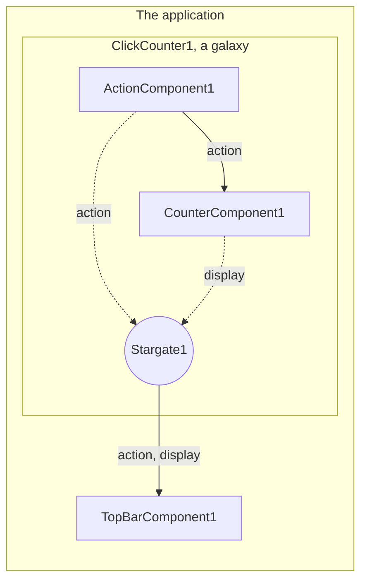

# Galaxies and stargates

A **galaxy** is a project file placed in another project as a single instance: a part of an application assembled once,
then placed as many times as needed, each instance with its own values. What the instance has, its interfaces and its
properties, is what the **stargates** of the galaxy expose of the instances inside it.

## Make a galaxy

Any project file is a galaxy, named after its file. This one is a button and the count of its clicks, from the
components of `WidgetsPlugin`: load it first in the **Plugins** tab, as [getting started](Getting-Started.md) does.

1. **File** > **New**. Place an `ActionComponent` and a `CounterComponent`, and bind the `action` of the first to the
   `action` of the second.
2. **Expose what the outside needs.** Right-click the edition zone, then **Add stargate**: `Stargate1` is placed, and its
   dialog opens. It lists, under each instance, its interfaces, then its properties. Check:
   - the `display` of `CounterComponent1`, the count to show;
   - the `action` of `ActionComponent1`, the button to put in a bar;
   - the `text` of `ActionComponent1`; double-click its row and name it `label`.

   Each is exposed under the name next to it, which you can change. Accept: the stargate shows the interfaces it
   exposes on its edges, bound to their instances, and its properties under them.
3. **File** > **Description...**: `A button and the count of its clicks`.
4. **File** > **Save As...**: `ClickCounter.nbp`, in `scene/`.

**Expose...**, in the context menu of the dot of an interface, does the same for a single interface: a stargate is
placed next to the instance, bound to the interface, and you type the name it is exposed as.

## Which way an interface goes

A stargate is the galaxy seen from the inside, so its interfaces go the other way round:

| Checked in the dialog | Once the galaxy is placed | Inside the galaxy |
| --- | --- | --- |
| An interface an instance **provides** | The galaxy provides it, on the right of its item | The stargate consumes it from that instance; it cannot do without it |
| An interface an instance **consumes** | The galaxy consumes it, on the left of its item | The stargate provides what the galaxy is given to the instances bound to it |

A project can have several stargates. Between them, the name of an interface is exposed once in each direction, the
name of a property once, and what one exposes, another cannot.

## Place it

1. **File** > **New**. Place a `MainWindowComponent` and a `TopBarComponent`, and bind their `mainWindow`.
2. **Drag `ClickCounter` from the Galaxies tab** into the edition zone, twice: `ClickCounter1` and `ClickCounter2`,
   each with the icon of the Galaxy, and the interfaces its stargate exposes, `action` and `display`, on its right.
   The plugins the galaxy needs are loaded then.
3. **Bind them** as any instance: each `action` to the `actions` of the bar, each `display` to its `widgets`.
4. **Set each one.** Select `ClickCounter2`: its properties are those the galaxy exposes, `label`. Set it to `Second`:
   that value is the one of this instance only.
5. **Start** (F5): the bar has two buttons and two counts, each counting its own.

The galaxy is held by its file: the project that places it saves the path to `ClickCounter.nbp`, relative to its own
file, the values of what it exposes, and what is bound to its interfaces. Keep the two files together when you move
them.

## Edit it

Double-click a galaxy placed, below its name, or **Open galaxy** in its context menu: the edition zone shows what is
inside, and the path above it tells where you are, **Application** › `ClickCounter1`. Edit it there as an application:
place, link, set, add stargates and settings files. Click **Application** in the path to come back.

- **Save Galaxy** (Ctrl+Alt+S), in the **File** menu or at the end of the path, writes the galaxy to its file, then
  reads every instance of that file again from it, wherever it is placed. Each instance keeps its name, the values of
  what it exposes, and what is bound to its interfaces under the names they still have; what one could not keep, a link
  to an interface no longer exposed, is told in a message box.
- Leaving a galaxy you changed asks: **Save** saves it, **Discard** reads it again from its file, **Cancel** stays.
- A stargate changed in a galaxy opened changes that instance at once; the other instances get it once it is saved.
- While the application runs, nothing is edited in a galaxy.

## What to know

- **A galaxy finds its plugins by their id**, among those NebulaStudio lists. In the **Galaxies** tab, one whose
  plugins are not all known is **Missing plugins**, and cannot be placed: open them with **Open plugin...**, or give
  their directory with `--plugin-dir`.
- **A galaxy cannot hold itself**, directly or through another one, nor the project it is placed in: NebulaStudio
  refuses it, and the status bar says so.
- **Each instance has its own settings files.** A settings file added inside a galaxy is named after each instance:
  `settings.json` of `ClickCounter1` is written as `ClickCounter1.settings.json`. See [settings files](Settings-Files.md).
- **The values in the file are those of new instances.** Saving the galaxy writes the values the instance edited has;
  those placed afterwards start with them, the others keep theirs.
- **A galaxy placed runs with the application**, its instances started in their order.

The [README](https://github.com/Shuko83/Nebula/blob/main/README.md#-project-file) tells how a project writes a galaxy
and a stargate, and the functions of `Nebula::Universe` that place and edit them from code.
