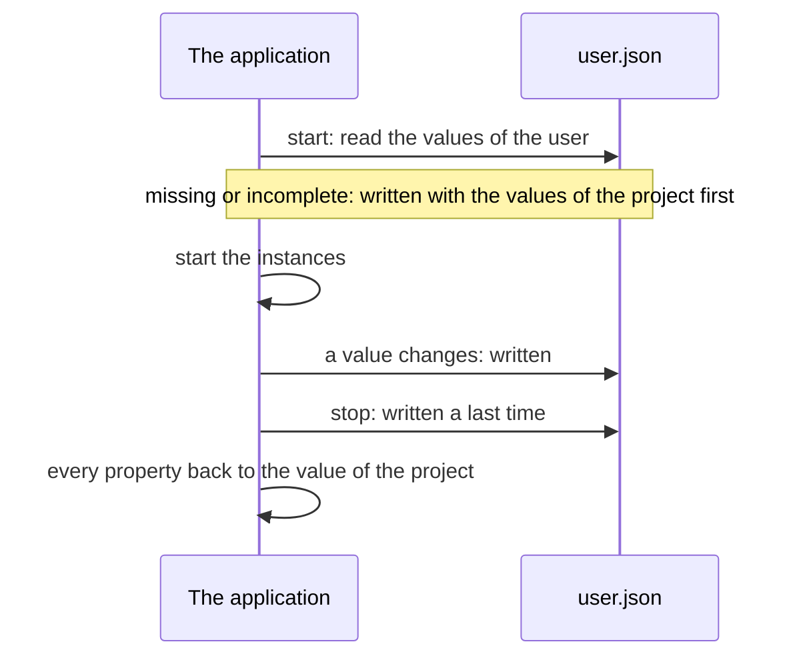

# Settings files

A **settings file** keeps the values that the user of an application gives some properties, from one run to the next:
the profile they chose, the level of the log, the size of a window. The project gives each of these properties its
default value; the file, read as the application starts, gives it the value of the user.

## What happens while the application runs

- A file that cannot be read is set aside, `.bak` added to its name, then written again with the values of the
  project.
- What else the file holds is kept: several applications can share one.
- When a file cannot be read or written, the application runs all the same; NebulaStudio says so in its status bar.

## Add one in NebulaStudio

1. Right-click the edition zone, then **Add settings file**: a sheet is placed, and its dialog opens.
2. **Name** the file, `settings.json` unless you give another name. Two files of an application cannot have the same
   name, whatever its case.
3. **Choose its directory**, or leave it empty: the configuration directory of the user, on Windows a folder under
   `%LOCALAPPDATA%` named after the organization and the name of the application. A relative directory is read from the
   directory of the application.
4. **Check the properties it holds**, under each instance, and the groups of its objects. Each shows its default value,
   the one of the project. The field above them filters them by name; **Held only** shows those checked.
5. Accept. Dashed lines join the file to the instances whose properties it holds.

Double-click the file, or **Edit settings file...** in its context menu, to change it later.

A property is held by one file at most: one that another file holds is shown with its name, and cannot be checked.
In the properties of an instance, a property a file holds is in *italics*.

## See and change what the user has

- **Select the file alone**: the right of the edition zone shows the values its file holds, under the names of their
  instances. A value in *italics* is not in the file yet: the default one, which the application writes there when it
  starts. Edit a value there to write it to the file at once, as if the user had chosen it.
- **View and edit file...**, in its context menu, shows the text of the file, which you can change: **OK** writes it as
  it is, once it is a JSON object.
- **Write default values** writes the values of the project to the file, in place of those of the user: to start your
  trials over, or to make the file you deliver.

Both follow the file: what the application writes there while it runs, or another program, is shown at once. While the
application runs, they are only shown.

## Where the file is while you try

Run from NebulaStudio, an application writes a file without a directory to the configuration directory of NebulaStudio,
not to the one of the application you deliver: what you try does not change what its users have. Selecting the file
shows where it is.

## What to know

- **The file holds the values under the names of the instances.** Rename an instance, and the values its user gave it
  stay under its former name: it starts again from the values of the project.
- **Each instance of a galaxy has its own file**, named after it: `settings.json` of `ClickCounter1` is
  `ClickCounter1.settings.json`. See [galaxies and stargates](Galaxies-and-Stargates.md).
- **Leave out a property that makes interfaces**, the `count` of a component that provides as many labels: changed
  while the application runs, what it removes loses its links, which stopping the application does not bring back.
- **A value that cannot be saved cannot be held**: a null date, a color that is not valid.
- **A file is not a preferences window.** Each component shows its own settings, a list where the user chooses a
  profile say; the file only keeps what they choose.

`ExternalPlugin` has an example: open `ExternalPlugin.nbdl`, in `ExternalPlugin/Release/lib/` of the zip of a release,
with **Open plugin...**. Its `ProfileSelector` provides the list of its `profiles`, in which the user chooses one: bind
its `display` to the `content` of a `Window`, hold its `profile` in a settings file, and **Start**. The profile chosen
is the one shown the next time.

The [README](https://github.com/Shuko83/Nebula/blob/main/README.md#-project-file) describes the file and how a project
writes it; `Nebula::SettingsFile` does the same from code.
